# 🚀 Ansible Day 1 – Introduction & Setup

> **Learning Ansible from the ground up — exploring automation, infrastructure management, and agentless configuration across servers.**

<p align="center">
  
  
  
  
</p>

---

# 📚 Table of Contents

> 💡 **Navigation Guide:** Click any topic in the Table of Contents to jump directly to that section. Some links may not work as expected.

- [🚀 1. Introduction to Ansible](#1--introduction-to-ansible)
  - [💡 1.1 What is Ansible?](#11-what-is-ansible)
  - [🌐 1.2 Where is Ansible Used?](#12-where-is-ansible-used)
  - [⚙️ 1.3 Configuration Management](#13-configuration-management)
  - [✨ 1.4 Advantages of Ansible](#14-advantages-of-ansible)

- [🏗️ 2. Ansible Architecture](#2--ansible-architecture)
  - [🖥️ 2.1 Control Node](#21-control-node)
  - [🎯 2.2 Managed Nodes](#22-managed-nodes)
  - [📋 2.3 Inventory](#23-inventory)
  - [📜 2.4 Playbooks](#24-playbooks)
  - [🧩 2.5 Modules](#25-modules)
  - [🔗 2.6 Architecture Components](#26-architecture-components-together)

- [🖥️ 3. Control Node](#3--control-node)
  - [🔍 3.1 What is a Control Node?](#31-what-is-a-control-node)
  - [🛠️ 3.2 Control Node Requirements](#32-what-is-required-on-a-control-node)
  - [⚡ 3.3 Automation Execution](#33-automation-execution-on-the-control-node)

- [🎯 4. Managed Nodes](#4--managed-nodes)
  - [🔍 4.1 What is a Managed Node?](#41-what-is-a-managed-node)
  - [📦 4.2 Managed Node Requirements](#42-what-is-required-on-a-managed-node)
  - [⚙️ 4.3 Tasks Performed on Managed Nodes](#43-what-tasks-can-be-performed-on-managed-nodes)
  - [❓ 4.4 Does Ansible Need to Be Installed on Managed Nodes?](#44-does-ansible-need-to-be-installed-on-managed-nodes)

- [🔌 5. Agentless Architecture](#5--agentless-architecture)
  - [🤖 5.1 What is an Agent?](#51-what-is-an-agent)
  - [💡 5.2 What is Agentless Architecture?](#52-what-is-agentless-architecture)
  - [🔄 5.3 How Ansible Works in an Agentless Architecture](#53-how-ansible-works-in-an-agentless-architecture)
  - [✨ 5.4 Advantages of Agentless Architecture](#54-advantages-of-agentless-architecture)
  - [⚠️ 5.5 Agentless Does Not Mean No Requirements](#55-agentless-does-not-mean-no-requirements)

- [🔐 6. SSH Connectivity](#6--ssh-connectivity)
  - [🔍 6.1 What is SSH?](#61-what-is-ssh)
  - [💻 6.2 Understanding the SSH Command](#62-understanding-the-ssh-command)
  - [🔑 6.3 SSH Authentication](#63-ssh-authentication)
  - [☁️ 6.4 SSH Connection to AWS EC2](#64-ssh-connection-to-aws-ec2)
  - [🔒 6.5 Private Key Permissions](#65-private-key-permissions)
  - [🛡️ 6.6 AWS Security Group](#66-aws-security-group)
  - [✅ 6.7 Verifying SSH Connectivity](#67-verifying-ssh-connectivity)

- [📥 7. Ansible Installation and Configuration](#7--ansible-installation-and-configuration)
  - [📍 7.1 Where Will We Install Ansible?](#71-where-will-we-install-ansible)
  - [🔄 7.2 Updating the System](#72-updating-the-system)
  - [📦 7.3 Installing Ansible](#73-installing-ansible)
  - [✅ 7.4 Verifying Installation](#74-verifying-installation)
  - [🔍 7.5 What Gets Installed?](#75-what-gets-installed)

- [🐍 8. Python Requirements](#8--python-requirements)
  - [❓ 8.1 Why is Python Required?](#81-why-is-python-required)
  - [🖥️ 8.2 Python on the Control Node](#82-python-on-the-control-node)
  - [🎯 8.3 Python on Managed Nodes](#83-python-on-managed-nodes)
  - [🔎 8.4 Verifying Python on Managed Nodes](#84-verifying-python-on-managed-nodes)

- [⚙️ 9. Ansible Configuration](#9--ansible-configuration)
  - [🔍 9.1 Verifying Configuration](#91-verifying-configuration)

- [🔐 10. SSH Connectivity – Practical Setup](#10--ssh-connectivity--practical-setup)
  - [🏗️ 10.1 Practical Architecture](#101-practical-architecture)
  - [🌐 10.2 What is a Private IP?](#102-what-is-a-private-ip)
  - [🛡️ 10.3 AWS Security Group Configuration](#103-aws-security-group-configuration)
  - [🔗 10.4 Connecting from Control Node to Managed Node](#104-connecting-from-control-node-to-managed-node)
  - [🔑 10.5 Making the SSH Key Available on the Control Node](#105-making-the-ssh-key-available-on-the-control-node)
  - [🔒 10.6 Setting SSH Key Permissions](#106-setting-ssh-key-permissions)
  - [✅ 10.7 Verifying SSH Connectivity](#107-verifying-ssh-connectivity)

- [🧪 11. Ansible Installation and Configuration – Practical Lab](#11--ansible-installation-and-configuration--practical-lab)
  - [📋 11.1 Lab Requirements](#111-lab-requirements)
  - [🐍 11.2 Verifying Python on the Control Node](#112-control-node--python-verification)
  - [📦 11.3 Installing Ansible on the Control Node](#113-control-node--ansible-installation)
  - [🔗 11.4 Verifying SSH Connectivity](#114-ssh-verification)
  - [🏗️ 11.5 Architecture After Ansible Installation](#115-architecture-after-ansible-installation)

- [🔄 12. Ansible Workflow](#12--ansible-workflow)
  - [▶️ 12.1 Executing an Ansible Command](#121-step-1--user-executes-an-ansible-command)
  - [⚙️ 12.2 Reading Configuration](#122-step-2--ansible-reads-configuration)
  - [📋 12.3 Reading Inventory](#123-step-3--ansible-reads-inventory)
  - [🎯 12.4 Selecting Target Hosts](#124-step-4--selecting-target-hosts)
  - [🔐 12.5 Establishing SSH Connection](#125-step-5--establishing-an-ssh-connection)
  - [📝 12.6 Executing Tasks](#126-step-6--executing-tasks)
  - [🧩 12.7 Executing Modules](#127-step-7--executing-modules-on-remote-systems)
  - [📤 12.8 Returning Results](#128-step-8--returning-results)
  - [📊 12.9 Execution Summary](#129-step-9--execution-summary)
  - [🔁 12.10 Complete Workflow](#1210-complete-workflow)

- [📝 13. Complete Day 1 Revision Notes](#13--complete-day-1-revision-notes)
- [⌨️ 14. Important Commands Learned](#14--important-commands-learned)
- [🔧 15. Predefined vs User-Created Components](#15--predefined-vs-user-created-components)
- [⚠️ 16. Common Mistakes](#16--common-mistakes--day-1)
- [🎓 17. What You Can Do After Day 1](#17--what-you-can-do-after-day-1)
- [🧠 18. Knowledge Check](#18--knowledge-check--day-1)
- [🏁 19. Final Recap](#19--final-recap)

---

# 1. 📖 Introduction to Ansible

## 1.1 What is Ansible?

> **Ansible is an open-source automation tool used for configuration management, application deployment, provisioning, and IT automation.**

In simple terms, imagine that you have 20 Linux servers and you need to perform the following tasks on all of them:

- Install Nginx.
- Create users.
- Update packages.
- Modify configuration files.
- Deploy applications.
- Start services.

If you perform these tasks manually, you need to log in to every server and execute the commands individually.

### 🖥️ Manual Approach

Suppose you have three servers:

| Server | IP Address |
|---|---|
| Server 1 | `10.0.1.10` |
| Server 2 | `10.0.1.11` |
| Server 3 | `10.0.1.12` |

You need to install Nginx on all three servers.

Manually, you would:

1. Connect to Server 1 using SSH.
2. Install Nginx.
3. Start the service.
4. Connect to Server 2.
5. Repeat the same process.
6. Connect to Server 3.
7. Repeat the process again.

This is manageable for three servers, but it becomes difficult when managing 100 or 500 servers.

### ⚙️ Ansible Approach

Ansible solves this problem.

You execute Ansible from a single machine, and it can automatically:

- Connect to remote servers.
- Execute commands.
- Install packages.
- Manage configurations.
- Manage services.
- Return execution results.

With Ansible, you can execute a single playbook to install Nginx across all three servers.

---

## 1.2 Where is Ansible Used?

Ansible is primarily used for the following tasks:

| Use Case | Description |
|---|---|
| ⚙️ Configuration Management | Managing server configurations |
| 🏗️ Provisioning | Preparing infrastructure or systems |
| 🚀 Application Deployment | Deploying applications |
| 📦 Package Management | Installing, updating, and removing packages |
| 🔄 Service Management | Starting, stopping, restarting, and enabling services |
| 👤 User Management | Creating and managing users and groups |
| ☁️ Cloud Automation | Automating cloud resources and configurations |
| 🔐 Security Automation | Applying security-related configurations |

### 🌍 Real-World Example

A company has 50 Ubuntu servers.

The company needs to:

- Install Nginx on every server.
- Create a specific user.
- Maintain SSH configuration.
- Maintain firewall configuration.
- Install a monitoring agent.

Ansible can be used to write an automation process and apply the same configuration across multiple servers.

---

## 1.3 Configuration Management

Configuration Management means maintaining systems in a required or desired configuration state.

Suppose you want:

> Nginx must be installed on all my web servers and its service must be running.

This is your **Desired State**.

Ansible checks:

- Is Nginx installed?
- If it is not installed, install it.
- Is the service running?
- If it is not running, start it.

The purpose is not just to execute commands, but to maintain the system in the desired state.

### 🔹 Imperative vs Desired State

#### Imperative Approach

You specify which commands need to be executed.

```bash
sudo apt update
sudo apt install nginx -y
sudo systemctl start nginx
```

#### Desired State Approach

You specify how the final system should look.

```yaml
nginx:
  installed: true
  running: true
```

This YAML is only for understanding the concept. Actual Ansible syntax will be studied later using proper modules.

In Ansible, we generally describe the desired state. Ansible determines the actions required to achieve that state.

---

## 1.4 Advantages of Ansible

### 1️⃣ Automation

Repeated tasks do not need to be performed manually.

### 2️⃣ Consistency

The same configuration can be applied across all servers.

### 3️⃣ Time Saving

The time required to configure hundreds of servers manually can be reduced.

### 4️⃣ Reduced Human Errors

The possibility of typing mistakes and configuration errors during repetitive manual operations is reduced.

### 5️⃣ Scalability

Automation can be managed across one server or hundreds/thousands of servers.

### 6️⃣ Reusability

Once a playbook is written, it can be reused multiple times.

### 7️⃣ Agentless Architecture

Dedicated Ansible agents generally do not need to be installed and continuously running on managed servers.

---

# 2. 🏗️ Ansible Architecture

Understanding Ansible architecture is very important because Inventory, Playbooks, Roles, and automation will work around this architecture.

## 🧩 Ansible Architecture Overview

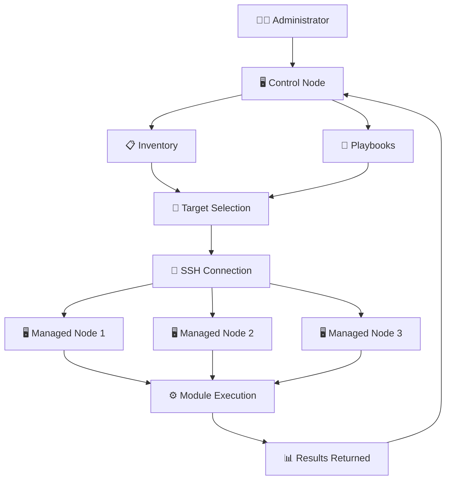

Ansible architecture consists of the following important components:

- 🖥️ Control Node
- 🖥️ Managed Nodes
- 📋 Inventory
- 📜 Playbooks
- ⚙️ Modules
- 🔐 SSH
- 🐍 Python
- 🚀 Execution Environment

Let's understand them.

---

## 2.1 🖥️ Control Node

The Control Node is the machine where Ansible is installed and automation is executed.

On this machine, you:

- Install Ansible.
- Maintain Inventory.
- Create Playbooks.
- Execute Ansible commands.
- Manage automation.

### Example

Your laptop or an AWS EC2 Ubuntu server can act as a Control Node.

```text
Your Laptop
   |
   | Ansible Installed
   |
   └── Control Node
```

If you are using a dedicated automation server in a production environment:

```text
Automation Server
      |
      | Ansible Installed
      |
      └── Control Node
```

### 📌 Important

Ansible is normally installed on the Control Node.

Ansible does not generally need to be installed on Managed Nodes.

---

## 2.2 🖥️ Managed Nodes

Managed Nodes are remote machines that Ansible manages or automates.

Examples:

- AWS EC2 instances
- Ubuntu servers
- Amazon Linux servers
- Debian servers
- Red Hat servers

### 🏗️ Example Architecture

```text
                🖥️ Control Node
                      |
                      | SSH
                      |
        ┌─────────────┼──────────────┐
        |             |              |
        ▼             ▼              ▼
   🖥️ Server 1   🖥️ Server 2   🗄️ Database
```

Here:

- The Control Node executes automation.
- Managed Nodes receive automation and perform tasks.

### 🌍 Real-World Example

A company has:

- 1 Ansible Control Node
- 10 Web Servers
- 2 Database Servers

Using Ansible, you can manage Web Servers and Database Servers in separate groups.

In the Inventory topic, we will learn how to define these groups.

---

## 2.3 📋 Inventory

Inventory tells Ansible which servers are available and which machines it should target.

An Inventory can contain:

- IP addresses
- Hostnames
- Server groups
- Connection information
- Host-specific variables

### Example Inventory

```ini
[webservers]
192.168.1.10
192.168.1.11

[dbservers]
192.168.1.20
```

### Understanding the Example

- `[webservers]` → Group name, chosen by you.
- `192.168.1.10` → Address of a managed server.
- `192.168.1.11` → Address of the second managed server.
- `[dbservers]` → Group name for database servers.
- `192.168.1.20` → Database server address.

The group names inside square brackets are part of the Ansible Inventory syntax, but the names `webservers` and `dbservers` are created by you.

### 📁 Inventory File Name

You can choose different names for the Inventory file, such as:

```text
inventory
hosts
my_servers
production.ini
```

We will study Inventory in detail later.

---

## 2.4 📜 Playbooks

A Playbook is a YAML file that defines what Ansible should do on managed servers.

### Example

```yaml
- name: Install Nginx
  hosts: webservers
  tasks:
    - name: Install nginx package
      ansible.builtin.package:
        name: nginx
        state: present
```

The deep syntax of this code will be studied in the Playbook topic.

For now, understand its architectural role:

- `hosts` determines which servers will be targeted.
- `tasks` defines the work to be performed.
- Modules perform the actual operations.

A Playbook contains your automation instructions.

---

## 2.5 ⚙️ Modules

A Module is an Ansible component that performs a specific operation.

### Examples

| Module | Purpose |
|---|---|
| `ansible.builtin.ping` | Check connectivity and Ansible execution |
| `ansible.builtin.package` | Manage packages |
| `ansible.builtin.service` | Manage services |
| `ansible.builtin.copy` | Copy files |
| `ansible.builtin.file` | Manage files and directories |
| `ansible.builtin.user` | Manage users |

For example, the Package Module can be used to install Nginx:

```yaml
ansible.builtin.package:
  name: nginx
  state: present
```

Here, the module tells Ansible to ensure that the package is installed.

Modules, their arguments, and practical usage will be studied later.

---

## 2.6 🧩 Architecture Components Together

| Component | Role |
|---|---|
| 🖥️ Control Node | Executes Ansible |
| 📋 Inventory | Contains managed servers and their grouping |
| 📜 Playbook | Defines automation instructions |
| 📝 Task | An individual automation step |
| ⚙️ Module | Performs a specific operation |
| 🔐 SSH | Establishes remote communication |
| 🖥️ Managed Node | Target server where automation is applied |
| 🐍 Python | Commonly required runtime for remote module execution |

---

# 3. 🖥️ Control Node

## 3.1 What is a Control Node?

A Control Node is the system where Ansible is installed and from which you control automation.

### Example

```text
Windows Laptop
   |
   └── Ubuntu VM
          |
          ├── Ansible
          ├── Inventory
          └── Playbooks
```

Alternatively:

```text
AWS EC2 - Ubuntu
   |
   ├── Ansible Installed
   ├── Inventory
   └── Playbooks
```

In both scenarios, the Ubuntu machine can act as a Control Node.

---

## 3.2 What is Required on a Control Node?

Normally, a Control Node requires:

- 🐧 Linux-based environment
- ⚙️ Ansible installed
- 🐍 Python environment
- 🔐 SSH client
- 🌐 Network access to Managed Nodes
- 🔑 SSH credentials or keys

### 💻 Your Learning Environment

You can use Windows while learning Ansible by using:

- Ubuntu VM
- Ubuntu EC2 instance

With this setup:

| Machine | Role |
|---|---|
| Ubuntu VM / Ubuntu EC2 | Control Node |
| AWS EC2 Instance 1 | Managed Node |
| AWS EC2 Instance 2 | Managed Node |

Ansible primarily supports Linux/Unix-based Control Node environments. Windows is not typically used as a traditional Linux-style Ansible Control Node; Windows users can use WSL or a Linux VM.

---

## 3.3 Automation Execution on the Control Node

Suppose you execute this command on the Control Node:

```bash
ansible-playbook install-nginx.yml
```

### Command Breakdown

| Component | Meaning |
|---|---|
| `ansible-playbook` | Ansible Playbook execution program |
| `install-nginx.yml` | Your Playbook file |

Ansible will:

1. Read the Playbook.
2. Read the Inventory.
3. Identify target servers.
4. Establish SSH connections.
5. Execute the required tasks.
6. Collect results.
7. Display execution results in the terminal.

The Control Node acts as the brain of the automation process.

---

# 4. 🖥️ Managed Nodes

## 4.1 What is a Managed Node?

A Managed Node is a server or machine managed by Ansible from a Control Node.

### Examples

- EC2 Ubuntu
- EC2 Amazon Linux
- Physical Linux server
- Virtual Machine
- Cloud VM

```text
🖥️ Control Node
Ubuntu
Ansible Installed
10.0.1.5

        |
        | SSH
        |
        ├─────────────────────┐
        |                    |
        ▼                    ▼

🖥️ Managed Node 1     🖥️ Managed Node 2
Ubuntu                Amazon Linux
10.0.1.10             10.0.1.11
```

---

## 4.2 What is Required on a Managed Node?

A typical Linux Managed Node requires:

- 🔐 SSH access
- 🐍 A compatible Python interpreter when Python-based modules are used
- 👤 A valid user
- 🔑 Required permissions
- 🌐 Network connectivity

Ansible generally does not need to be installed on Managed Nodes.

### Example

The Control Node can manage both machines:

```text
          Control Node
               |
              SSH
               |
       ┌───────┴────────┐
       |               |
       ▼               ▼
 Managed Node 1   Managed Node 2
    Ubuntu         Amazon Linux
```

---

## 4.3 What Tasks Can Be Performed on Managed Nodes?

Using Ansible, you can:

- 📦 Install Nginx.
- 🐳 Install Docker.
- 🔄 Update packages.
- 👤 Create users.
- 📁 Copy files.
- 🔧 Restart services.
- 🔥 Configure firewalls.
- 🚀 Deploy applications.
- 📝 Update configuration files.

For example, if you have 50 EC2 instances, Ansible can apply a common configuration across all of them.

---

## 4.4 Does Ansible Need to Be Installed on Managed Nodes?

> ❌ Generally, no.

Ansible uses an agentless architecture. Therefore, a dedicated Ansible agent does not need to be continuously running on typical Linux Managed Nodes.

However, Python may be required on Managed Nodes to execute remote modules.

### Important Distinction

| Software | Control Node | Managed Node |
|---|---|---|
| Ansible | Required | Generally not required |
| SSH | Client required | SSH Server required |
| Python | Ansible runtime requirement | Generally required for modules |
| Playbooks | Stored and executed here | Usually not required |
| Inventory | Maintained on Control Node | Not required |

---

# 5. 🔌 Agentless Architecture

Agentless architecture is one of the most important features of Ansible.

## 5.1 What is an Agent?

In traditional configuration management systems, an Agent is software installed on a managed server.

An Agent may:

- Run in the background.
- Communicate with a central server.
- Receive configuration.
- Execute tasks.
- Send status reports.

### 🏗️ Agent-Based Architecture

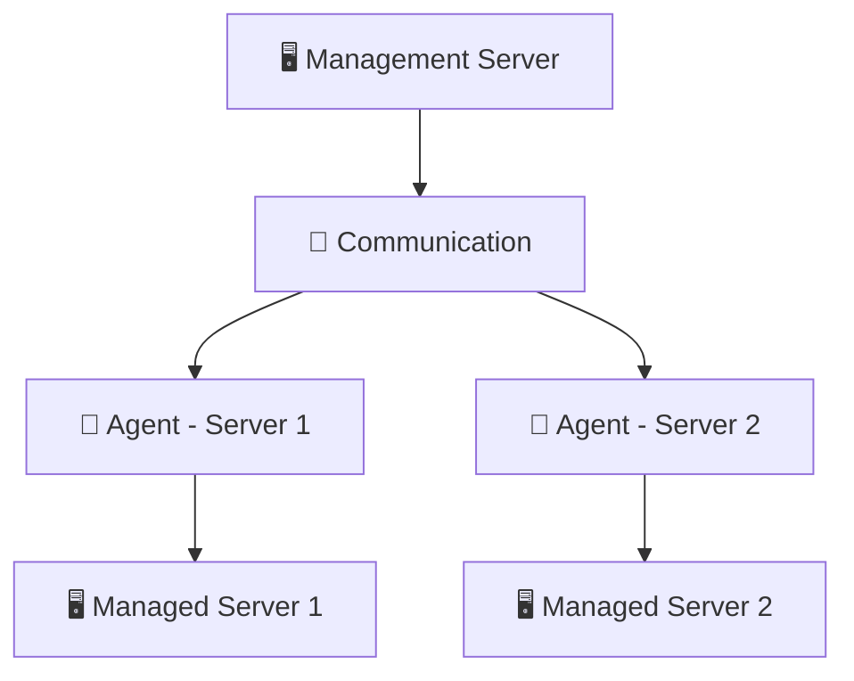

Each managed server may require agent software to be maintained.

---

## 5.2 What is Agentless Architecture?

Agentless means:

> There is no requirement to install and continuously run a dedicated Ansible agent on Managed Nodes.

Ansible typically connects to remote servers through SSH from the Control Node.

### 🏗️ Ansible Agentless Architecture

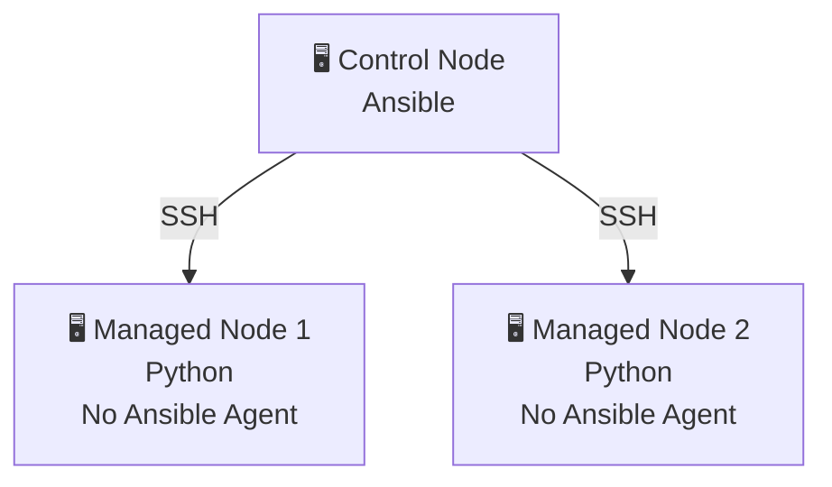

---

## 5.3 How Ansible Works in an Agentless Architecture

Suppose you execute a Playbook from the Control Node.

### 🔹 Step 1 – Ansible Reads Inventory

Ansible identifies which servers are targeted.

### 🔹 Step 2 – Establishes an SSH Connection

The Control Node connects to the remote server using SSH.

### 🔹 Step 3 – Checks the Remote Environment

Ansible checks the required environment, permissions, and Python availability according to the task requirements.

### 🔹 Step 4 – Module Transfer / Execution Mechanism

Ansible may temporarily transfer and execute required module code on the remote machine, typically for Python-based modules.

### 🔹 Step 5 – Returns Results

The execution result is returned from the remote server to the Control Node.

### 🔹 Step 6 – Temporary Files Cleanup

Temporary files may be cleaned up according to the execution mechanism.

> Ansible generally does not maintain a permanently running agent on managed servers.

---

## 5.4 Advantages of Agentless Architecture

- 🚫 No dedicated Ansible agent installation on Managed Nodes.
- 🔧 Less agent version management.
- ⚡ Relatively simple setup.
- 🔐 Uses SSH, which is commonly available in Linux infrastructure.
- 🪶 Lightweight management of remote systems.

---

## 5.5 Agentless Does Not Mean No Requirements

Even though Ansible is agentless, the following are still required:

- 🌐 Network connectivity
- 🔐 SSH
- 🔑 Valid credentials
- 🔒 Required permissions
- 🐍 Python, commonly required for Python-based modules
- 🖥️ Reachable remote server

### ❌ Common Misunderstanding

**Agentless = Ansible works without any software or connectivity.**

### ✅ Correct Understanding

**Agentless = A dedicated Ansible agent generally does not need to be permanently installed and running on Managed Nodes.**

---

# 6. 🔐 SSH Connectivity

Now we will understand one of the most important communication mechanisms used by Ansible.

## 6.1 What is SSH?

SSH stands for:

> **Secure Shell**

SSH is a network protocol that allows you to securely access a remote machine.

### Example

You have an Ubuntu terminal on your laptop and an Ubuntu server on AWS EC2.

You can connect from your laptop to the EC2 instance using SSH:

```bash
ssh ubuntu@10.0.1.10
```

This command allows you to access the remote server's terminal.

---

## 6.2 Understanding the SSH Command

```bash
ssh ubuntu@10.0.1.10
```

| Part | Meaning |
|---|---|
| `ssh` | SSH client command |
| `ubuntu` | Remote Linux user |
| `@` | Separates username and host |
| `10.0.1.10` | Remote server IP |

`ubuntu` is not a universal predefined username. It is commonly the default username for Ubuntu EC2 images.

Different OS images may use different usernames:

| OS / Image | Common SSH Username |
|---|---|
| Ubuntu | `ubuntu` |
| Amazon Linux | `ec2-user` |
| Debian | `admin` or image-specific user |
| RHEL | `ec2-user` or configured user |

The username depends on the image and configuration.

---

## 6.3 SSH Authentication

SSH requires authentication to establish a connection.

Common authentication methods include:

### 1️⃣ Password Authentication

Authentication using a username and password.

```bash
ssh user@server-ip
```

A password prompt will appear.

### 2️⃣ SSH Key Authentication

SSH keys are used.

The two important concepts are:

- 🔑 Private Key
- 🔓 Public Key

### 🔑 Private Key

The private key is securely stored with you.

Example:

```text
my-key.pem
```

The private key must not be shared with unauthorized people.

### 🔓 Public Key

The public key can be placed in the remote server's authorized keys configuration.

### 🔐 Authentication Flow

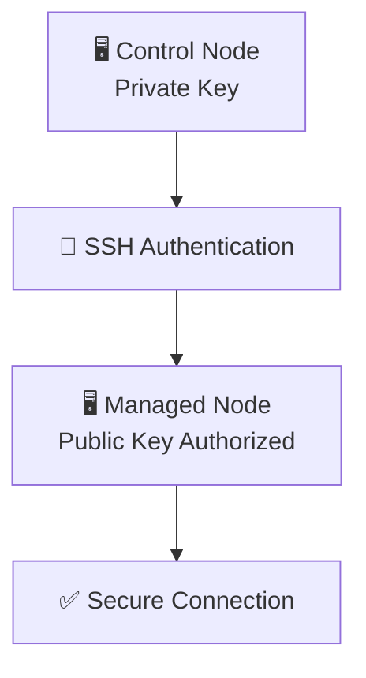

The server can verify that the connecting client possesses the corresponding private key.

---

## 6.4 SSH Connection to AWS EC2

Suppose you launched an Ubuntu EC2 instance on AWS.

You have:

- Public IP: `54.123.45.67`
- Username: `ubuntu`
- Private Key: `my-key.pem`

### Command – On the Control Node / Local Linux Environment

```bash
ssh -i my-key.pem ubuntu@54.123.45.67
```

### Complete Breakdown

| Part | Meaning |
|---|---|
| `ssh` | SSH client command |
| `-i` | Option to specify the identity file |
| `my-key.pem` | Path to the private key file |
| `ubuntu` | Remote username |
| `@` | Username and server address separator |
| `54.123.45.67` | EC2 Public IP |

`-i` means identity file.

If the private key is not in the current directory, you can specify its full path.

```bash
ssh -i ~/.ssh/my-key.pem ubuntu@54.123.45.67
```

Here:

- `~` → Current Linux user's home directory.
- `.ssh` → Commonly used directory for SSH configuration and keys.
- `my-key.pem` → Private key.

---

## 6.5 Private Key Permissions

Linux SSH private key permissions should be restrictive.

### Command

```bash
chmod 400 my-key.pem
```

This command changes the permissions of the private key file.

### `chmod`

Linux command used to change file permissions.

### `400`

Permission representation:

- Owner → Read
- Group → No permission
- Others → No permission

The owner can read the private key, but write and execute permissions are not granted.

Restrictive permissions are commonly required for AWS EC2 SSH keys.

If the key permissions are too open, SSH may show an error:

```text
WARNING: UNPROTECTED PRIVATE KEY FILE!
Permissions ... are too open.
```

### Fix

```bash
chmod 400 my-key.pem
```

**Execute this command on the machine where the private key file is stored.**

---

## 6.6 AWS Security Group

On AWS EC2, SSH connectivity requires port 22 to be allowed in the Security Group.

### 🔐 SSH Default Port

```text
22
```

### Security Group Inbound Rule

| Type | Protocol | Port | Source |
|---|---|---:|---|
| SSH | TCP | 22 | Your IP |

### What is Inbound?

Inbound traffic means traffic coming toward the EC2 instance.

Your laptop sends an SSH connection request to EC2, so the EC2 Security Group needs an inbound SSH rule.

### What is Source?

Source defines which IP address or network is allowed to send traffic.

### Security Best Practice

Prefer:

```text
Your Public IP/32
```

Avoid:

```text
0.0.0.0/0
```

If SSH is globally open, connection attempts can be made from any IPv4 address on the internet. This creates an unnecessary security risk.

---

## 6.7 Verifying SSH Connectivity

After establishing the SSH connection, execute the following commands on the remote server.

### 🔹 Check Hostname

```bash
hostname
```

Displays the hostname of the remote server.

### 🔹 Check Current User

```bash
whoami
```

Displays the user under which you are currently logged in.

### 🔹 Check Network Interfaces

```bash
ip addr
```

Displays network interfaces and IP addresses.

### 🔹 Exit SSH Session

```bash
exit
```

Exits the remote SSH session.

> ⚠️ These commands should be executed inside the remote SSH session after successfully logging in to the server.

---

# 7. ⚙️ Ansible Installation and Configuration

Now we will understand the installation environment and practical setup required to install Ansible.

## 7.1 Where Will We Install Ansible?

We will use an Ubuntu machine as the Control Node.

### 🏗️ Learning Environment

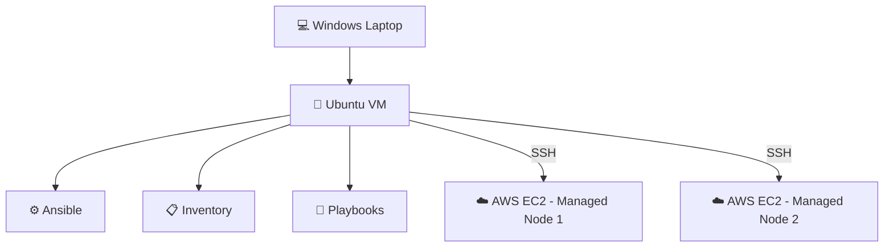

Alternatively, the Control Node can directly be an Ubuntu EC2 instance.

Ansible Day 1 commands will be executed on the Ubuntu Control Node.

---

## 7.2 Updating the System

### 📍 Machine: Ubuntu Control Node

```bash
sudo apt update
```

### `sudo`

Executes a command with elevated privileges.

Normally, the current user has limited permissions. Administrative privileges are required to update system package information.

### `apt`

The package management tool used by Ubuntu and Debian.

Package management means installing, updating, and removing software.

### `update`

Refreshes package information from APT repositories.

It does not automatically upgrade the actual installed software.

---

## 7.3 Installing Ansible

For a beginner lab, Ansible can be installed using the Ubuntu package manager.

### 📍 Machine: Ubuntu Control Node

```bash
sudo apt install ansible -y
```

### Complete Breakdown

| Part | Meaning |
|---|---|
| `sudo` | Administrative privileges |
| `apt` | Package manager |
| `install` | Package installation operation |
| `ansible` | Package name |
| `-y` | Automatically confirms installation prompts |

### What is `-y`?

`-y` is generally a yes/confirmation flag.

If you remove it:

```bash
sudo apt install ansible
```

The package manager may ask for confirmation:

```text
Do you want to continue? [Y/n]
```

If you use `-y`, the confirmation is automatically accepted.

### Is `-y` Mandatory?

❌ No.

It is optional.

---

## 7.4 Verifying Installation

### 📍 Machine: Ubuntu Control Node

```bash
ansible --version
```

This command displays Ansible version and related information.

### Example Output

```text
ansible [core 2.x.x]
python version = 3.x.x
```

The actual version will depend on your installation.

### `--version`

The double-hyphen option displays version information.

Single-hyphen and double-hyphen flags are common conventions in Linux programs, but their exact syntax depends on the tool.

---

## 7.5 What Gets Installed?

Ansible installation commonly includes:

- ⚙️ Ansible Core
- 🐍 Required Python dependencies
- 🔧 Supporting executables
- 📝 Configuration-related components

The exact installed packages and dependencies depend on the Ubuntu package version.

---

# 8. 🐍 Python Requirements

This topic is important because Ansible is closely related to the Python ecosystem.

## 8.1 Why is Python Required?

Ansible's major components are based on the Python ecosystem.

The Control Node requires a Python runtime.

Python is also generally required on remote Linux Managed Nodes, especially for executing standard Python-based Ansible modules.

### 🏗️ Architecture

```text
🖥️ Control Node
   |
   ├── ⚙️ Ansible
   ├── 🐍 Python
   |
   | SSH
   |
🖥️ Managed Node
   |
   └── 🐍 Python
```

---

## 8.2 Python on the Control Node

Python is required on the Control Node for Ansible's execution environment.

Ubuntu may already have Python installed.

### Check Python

📍 **Machine: Ubuntu Control Node**

```bash
python3 --version
```

### Breakdown

- `python3` → Python 3 interpreter executable.
- `--version` → Displays the installed version.

### Example

```text
Python 3.12.x
```

The actual version depends on your Ubuntu release.

### Why `python3` and Not `python`?

On Linux systems, the behavior of the `python` command can vary depending on the system and configuration.

`python3` explicitly invokes the Python 3 interpreter.

---

## 8.3 Python on Managed Nodes

Python is generally required on Managed Nodes because Ansible commonly executes remote Python modules.

### Example Workflow

```text
🖥️ Control Node
      |
      | SSH
      |
🖥️ Managed Node
      |
      | Python
      |
      └── Module Execution
```

Suppose Ansible executes a task to install a package on the Managed Node.

The remote Python environment may be required for module execution, depending on the module and execution method.

### If Python Is Missing

Errors may look like:

```text
Python interpreter not found
```

Or:

```text
Failed to find a suitable Python interpreter
```

In such cases, Ansible may be unable to locate Python on the remote node.

Some Linux systems have Python preinstalled, while some minimal server images may not.

---

## 8.4 Verifying Python on Managed Nodes

After connecting to the Managed Node through SSH:

```bash
python3 --version
```

If Python is available, the version will be displayed.

If `command not found` appears, Python 3 may not be installed.

### Installing Python on Ubuntu Managed Node

📍 **Machine: Ubuntu Managed Node**

```bash
sudo apt update
sudo apt install python3 -y
```

### Installing Python on Amazon Linux

Amazon Linux uses a different package manager.

📍 **Machine: Amazon Linux Managed Node**

```bash
sudo dnf install python3 -y
```

### Ubuntu vs Amazon Linux

| Ubuntu | Amazon Linux |
|---|---|
| `apt` | `dnf` |
| Debian package ecosystem | RPM package ecosystem |
| Common default username: `ubuntu` | Common default username: `ec2-user` |

### 📌 Important

Ansible installation is performed on the Control Node.

The remote Python requirement is for module execution on Managed Nodes.

---

# 9. ⚙️ Ansible Configuration

Ansible's behavior can be controlled through a configuration file.

The commonly used configuration file is:

```text
ansible.cfg
```

This configuration file tells Ansible what its default behavior should be.

Example settings may include:

- 📋 Inventory file location.
- 👤 Remote user.
- 🔐 SSH configuration.
- ⬆️ Privilege escalation defaults.
- 📊 Output settings.

Common Ansible configuration file locations include:

```text
/etc/ansible/ansible.cfg
```

Or inside a project directory:

```text
ansible.cfg
```

Keeping project-specific configuration allows you to manage separate settings for different projects.

Ansible configuration precedence and configuration file search rules are advanced details that will be covered later.

---

## 9.1 Verifying Configuration

### 📍 Machine: Ubuntu Control Node

```bash
ansible --version
```

The output may also display the Ansible configuration file path, depending on the installation and configuration.

### Inspecting Configuration

```bash
ansible-config dump
```

This command displays the current Ansible configuration settings.

### `ansible-config`

An Ansible configuration inspection utility.

### `dump`

A subcommand that displays current configuration values.

The output can be lengthy. Later, we will learn how to identify useful configuration settings.

---

# 10. 🔐 SSH Connectivity – Practical Setup

We have already understood the SSH concept.

Now we will see how to prepare connectivity between the Ansible Control Node and Managed Nodes.

## 10.1 Practical Architecture

### 🏗️ Our Setup

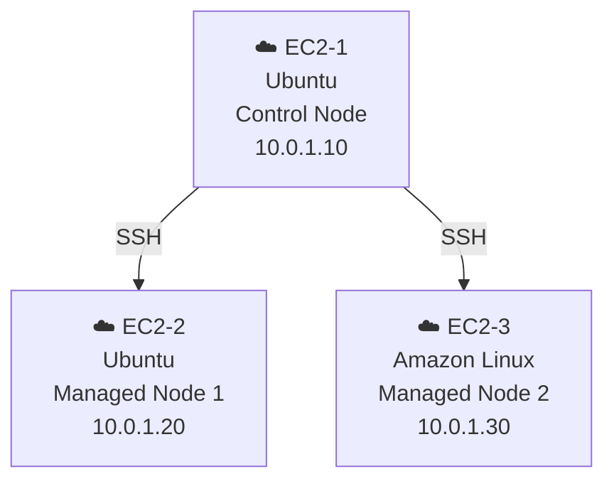

We will consider the following setup:

| Machine | OS | Role |
|---|---|---|
| EC2-1 | Ubuntu | Control Node |
| EC2-2 | Ubuntu | Managed Node 1 |
| EC2-3 | Amazon Linux | Managed Node 2 |

### Example Private IP Addresses

| Machine | Private IP |
|---|---|
| Control Node | `10.0.1.10` |
| Managed Node 1 | `10.0.1.20` |
| Managed Node 2 | `10.0.1.30` |

> ⚠️ These IP addresses are examples. Your actual EC2 IP addresses will be different.

---

## 10.2 What is a Private IP?

A Private IP address is used for internal network communication.

Within an AWS VPC, EC2 instances can communicate using private IP addresses, provided the networking and security rules allow it.

### 🏗️ Private Network Architecture

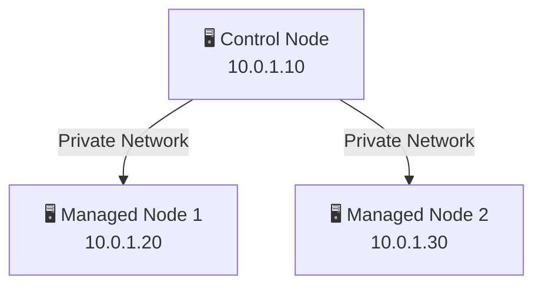

### 🌐 Public IP vs Private IP

| Public IP | Private IP |
|---|---|
| Can be used for internet-facing connectivity | Used for internal network communication |
| May be reachable from the internet, subject to security rules | Reachable through internal network/VPC connectivity |
| Can be used for internet-facing SSH setups | Preferred for internal Ansible communication |

If the Control Node and Managed Nodes are in the same VPC or properly connected networks, private IP addresses can be used for SSH communication.

---

## 10.3 AWS Security Group Configuration

For Ansible communication, SSH inbound access must be allowed in the Managed Nodes' Security Groups.

### 🔐 Managed Nodes Security Group Rule

| Type | Port | Protocol | Source |
|---|---:|---|---|
| SSH | 22 | TCP | Control Node Security Group |

### Why Use the Control Node Security Group as the Source?

If you specify the Control Node's Security Group as the source, instances associated with that Security Group can be allowed as the source, subject to AWS Security Group rules and network setup.

This avoids unnecessarily opening SSH access to all IP addresses.

### 🌐 Network Requirements

For SSH communication to work:

- The Control Node must have a network route to Managed Nodes.
- The Managed Node Security Group must allow SSH.
- Network ACLs must not block the traffic.
- The SSH server must be available on the remote machine.
- The correct username and authentication credentials must be used.

---

## 10.4 Connecting from Control Node to Managed Node

If the SSH private key is available on the Control Node:

### 📍 Machine: Control Node

```bash
ssh -i my-key.pem ubuntu@10.0.1.20
```

For an Amazon Linux server:

```bash
ssh -i my-key.pem ec2-user@10.0.1.30
```

### Notice

- Ubuntu username → `ubuntu`
- Amazon Linux username → `ec2-user`

These usernames depend on the image's default configuration.

---

## 10.5 Making the SSH Key Available on the Control Node

If the Control Node is an AWS EC2 instance and it needs to connect to other EC2 instances, the Managed Nodes' SSH private key must be securely available to the Control Node.

### Private Key Name

```text
ansible-key.pem
```

### Example Directory

```text
/home/ubuntu/.ssh/ansible-key.pem
```

> ⚠️ Security Warning: Never upload private keys to GitHub. Uploading a `.pem` key to a public repository is extremely dangerous.

---

## 10.6 Setting SSH Key Permissions

📍 **Machine: Control Node**

```bash
chmod 400 ~/.ssh/ansible-key.pem
```

### Command Breakdown

- `chmod` → Modifies file permissions.
- `400` → Owner read permission; no permissions for group or others.
- `~` → Current user's home directory.
- `.ssh` → Commonly used directory for SSH files.
- `ansible-key.pem` → Your private key.

If the file is stored somewhere else, change the path accordingly.

---

## 10.7 Verifying SSH Connectivity

📍 **Machine: Control Node**

```bash
ssh -i ~/.ssh/ansible-key.pem ubuntu@10.0.1.20
```

### Expected Behavior

- SSH connection is established.
- A remote shell opens.
- You enter the Managed Node's terminal.

### Verify on the Remote Server

```bash
hostname
```

```bash
whoami
```

```bash
python3 --version
```

### Exit the Session

```bash
exit
```

> ✅ Day 1 SSH Practical Goal: Before running Ansible, the SSH connection from the Control Node to the Managed Node should be successful when tested manually.

---

# 11. 🧪 Ansible Installation and Configuration – Practical Lab

Now let's prepare a basic setup.

## 11.1 Lab Requirements

### 🏗️ Required Machines

- 🖥️ 1 Ubuntu Control Node
- 🖥️ 2 Linux Managed Nodes

For learning purposes, you can start with just one Managed Node.

### Control Node Requirements

- Ubuntu
- Ansible
- Python 3
- SSH client
- Network connectivity to Managed Nodes
- SSH credentials for Managed Nodes

### Managed Node Requirements

- Linux
- SSH Server
- Python 3 for standard Python-based modules
- SSH access
- Required permissions

---

## 11.2 Control Node – Python Verification

📍 **Machine: Ubuntu Control Node**

```bash
python3 --version
```

If Python is installed, its version will be displayed.

If Python is missing, install it on Ubuntu:

```bash
sudo apt update
sudo apt install python3 -y
```

---

## 11.3 Control Node – Ansible Installation

📍 **Machine: Ubuntu Control Node**

### Step 1 – Update Package Information

```bash
sudo apt update
```

Refreshes package information.

### Step 2 – Install Ansible

```bash
sudo apt install ansible -y
```

Installs Ansible.

### Step 3 – Verify Installation

```bash
ansible --version
```

Verifies the Ansible installation.

---

## 11.4 SSH Verification

📍 **Machine: Ubuntu Control Node**

```bash
ssh -i ~/.ssh/ansible-key.pem ubuntu@10.0.1.20
```

If login is successful, SSH communication is working.

Exit the session:

```bash
exit
```

---

## 11.5 Architecture After Ansible Installation

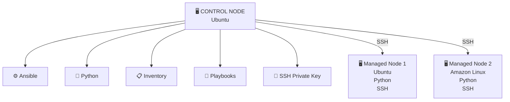

---

# 12. 🔄 Ansible Workflow

Now we will study the final and very important topic of Day 1: **Ansible Workflow**.

Workflow means understanding what happens internally after executing an Ansible command and how automation gets completed.

## 🏗️ Ansible Workflow Overview

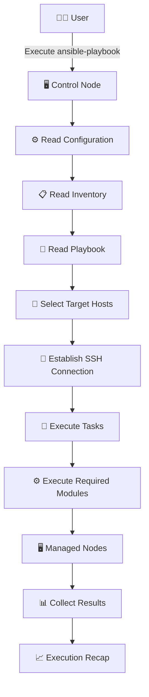

---

## 12.1 Step 1 – User Executes an Ansible Command

On the Control Node, you execute:

```bash
ansible-playbook site.yml
```

### Command Breakdown

- `ansible-playbook` → Ansible Playbook execution command.
- `site.yml` → Playbook file.
- `site.yml` is created by you.

---

## 12.2 Step 2 – Ansible Reads Configuration

Ansible checks its configuration settings.

Configuration may provide information such as:

- Inventory location
- SSH behavior
- Defaults
- Other execution settings

If you are using project-specific configuration, the applicable settings determine execution behavior.

---

## 12.3 Step 3 – Ansible Reads Inventory

Ansible reads the Inventory and identifies managed servers.

### Example

```text
webservers

10.0.1.20
10.0.1.30
```

Ansible determines which hosts to execute tasks on according to the requested target.

---

## 12.4 Step 4 – Selecting Target Hosts

Target machines are identified according to the Playbook's `hosts` section or command-line host selection.

### Example

```text
webservers
```

If the Inventory contains five web servers, Ansible can execute tasks on those servers according to the target selection.

---

## 12.5 Step 5 – Establishing an SSH Connection

The Control Node connects to the selected Managed Nodes using SSH.

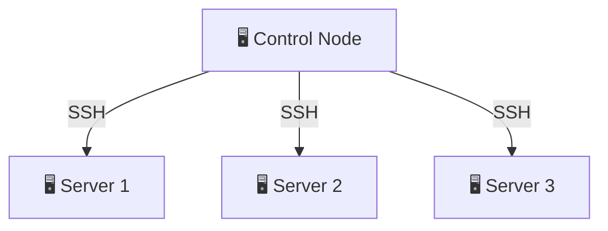

SSH authentication must be successful.

---

## 12.6 Step 6 – Executing Tasks

Tasks are executed in sequence according to the Playbook.

### Example Tasks

1. Install Nginx.
2. Copy configuration file.
3. Start the Nginx service.

Ansible executes these tasks through the required modules.

---

## 12.7 Step 7 – Executing Modules on Remote Systems

Suppose the task is to install Nginx.

Ansible uses a package management module to perform the required package operation on the remote server.

If the remote system is Ubuntu, its package manager is generally `apt`.

If the remote system is Amazon Linux, its package manager is generally `dnf`.

Ansible modules help handle the required operation through the appropriate package manager.

---

## 12.8 Step 8 – Returning Results

Ansible task results are returned to the Control Node.

Common result statuses include:

- `ok`
- `changed`
- `failed`
- `skipped`
- `unreachable`

These statuses will be studied in detail in the Playbook execution topic.

---

## 12.9 Step 9 – Execution Summary

After the Playbook finishes, Ansible displays a recap.

### Example Output

```text
PLAY RECAP

server1 : ok=3 changed=1 unreachable=0 failed=0
server2 : ok=3 changed=1 unreachable=0 failed=0
```

> 📝 This is example output.

### Basic Status Meanings

| Status | Meaning |
|---|---|
| `ok` | Task executed successfully; no change was necessary, or the task completed successfully |
| `changed` | The task made a change to the system |
| `unreachable` | Ansible could not connect to the target |
| `failed` | Task execution failed |

Remember Ansible's important behavior:

> Ansible executes automation, collects results from remote systems, and displays an execution summary on the Control Node.

---

## 12.10 Complete Workflow – One Flow

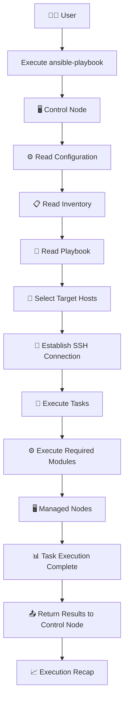

This is the basic end-to-end workflow of Ansible.

---

# 13. 📚 Complete Day 1 Revision Notes

Today, we built the foundation of Ansible.

All important concepts are summarized below.

## 13.1 Important Concepts

| Concept | Meaning |
|---|---|
| ⚙️ Ansible | Infrastructure and server automation tool |
| 🤖 Automation | Automatically performing repetitive tasks |
| 🔧 Configuration Management | Maintaining servers in required configurations |
| 🖥️ Control Node | Machine where Ansible is installed and executed |
| 🖥️ Managed Node | Server managed by Ansible |
| 🚫 Agentless | No dedicated Ansible agent required on Managed Nodes |
| 🔐 SSH | Secure remote communication protocol |
| 📋 Inventory | List and grouping of managed servers |
| 📜 Playbook | YAML file containing automation instructions |
| 📝 Task | Individual step of a Playbook |
| ⚙️ Module | Ansible component that performs a specific operation |
| 🐍 Python | Runtime commonly required for Ansible and remote module execution |

---

# 14. 💻 Important Commands Learned

> 📍 These commands are primarily executed on the Ubuntu Control Node unless another machine is specifically mentioned.

### 🔄 Update System Package Information

```bash
sudo apt update
```

Refreshes package information from Ubuntu repositories.

---

### 📦 Ansible Installation

```bash
sudo apt install ansible -y
```

Installs Ansible on Ubuntu.

---

### 🔎 Ansible Version Check

```bash
ansible --version
```

Verifies Ansible installation and displays its version.

---

### 🐍 Python Version Check

```bash
python3 --version
```

Verifies Python 3 availability.

---

### 🔐 SSH Connection

```bash
ssh -i my-key.pem ubuntu@SERVER_IP
```

Connects to a remote server using a private key.

---

### 🔑 SSH Private Key Permissions

```bash
chmod 400 my-key.pem
```

Sets restrictive permissions on the private key.

---

### 🚪 Exit SSH Session

```bash
exit
```

Exits the remote shell.

---

### ⚙️ Inspect Configuration

```bash
ansible-config dump
```

Displays Ansible configuration values.

---

# 15. 🔍 Predefined vs User-Created Components

This distinction is very important while learning Ansible.

| Item | Predefined or User-Created? |
|---|---|
| `ansible-playbook` | Predefined Ansible command |
| `ansible` | Predefined Ansible command |
| `apt` | Linux package manager |
| `ssh` | SSH client command |
| `chmod` | Linux command |
| `python3` | Python interpreter executable |
| `ansible.cfg` | Standard configuration filename; you can create/configure the file |
| `inventory` | File name can be chosen by you |
| `webservers` | Group name created by you |
| `dbservers` | Group name created by you |
| `site.yml` | Playbook filename chosen by you |
| `my-key.pem` | Private key filename from your environment |
| IP Address | Actual address of your infrastructure |
| `ubuntu` | Common default SSH username for Ubuntu EC2; depends on image/configuration |
| `ec2-user` | Common default SSH username for Amazon Linux; depends on image/configuration |

---

# 16. ⚠️ Common Mistakes – Day 1

### ❌ 1. Installing Ansible on Managed Nodes

Ansible is normally installed on the Control Node. Managed Nodes generally do not need a dedicated Ansible agent.

---

### ❌ 2. Running Ansible Without Testing SSH

Always verify that the Control Node can connect to the Managed Node through SSH before running Ansible.

---

### ❌ 3. Using the Wrong SSH Username

Ubuntu commonly uses `ubuntu`, while Amazon Linux commonly uses `ec2-user`.

Using the wrong username can cause login failures.

---

### ❌ 4. Private Key Permission Issues

SSH may refuse to use a private key if its permissions are too open.

The commonly used fix:

```bash
chmod 400 my-key.pem
```

---

### ❌ 5. SSH Port 22 Blocked in Security Group

If inbound SSH access is not allowed, the connection may time out.

---

### ❌ 6. Python Missing

Missing Python on a Managed Node can prevent Python-based Ansible modules from executing.

---

### ❌ 7. Confusing Private and Public IPs

Private IP communication requires the Control Node and Managed Node to have appropriate private networking and routing.

---

### ❌ 8. Sharing Private Keys

Never share `.pem` private keys with GitHub, public repositories, or unauthorized users.

---

# 17. 🎯 What You Can Do After Day 1

After completing Day 1, you can:

- ✅ Explain the purpose of Ansible.
- ✅ Understand Configuration Management.
- ✅ Identify Control Nodes and Managed Nodes.
- ✅ Explain Agentless Architecture.
- ✅ Understand the basic working of SSH.
- ✅ Understand the difference between Public and Private IPs.
- ✅ Identify AWS EC2 SSH connection requirements.
- ✅ Set SSH key permissions.
- ✅ Install Ansible on Ubuntu.
- ✅ Check Ansible and Python versions.
- ✅ Explain why Python is important for Ansible.
- ✅ Describe the complete Ansible execution workflow.

---

# 18. 📝 Knowledge Check – Day 1

Try to answer these questions yourself.

> 🎯 These questions are optional to answer. You do not need to pass this test to continue to the next Day.

<details>
<summary><strong>Q1. What is the difference between a Control Node and a Managed Node?</strong></summary>

The Control Node is where Ansible is installed and executed. Managed Nodes are the remote servers that Ansible manages.
</details>

<details>
<summary><strong>Q2. Why is Ansible called Agentless?</strong></summary>

Because a dedicated Ansible agent generally does not need to be installed and continuously running on Managed Nodes.
</details>

<details>
<summary><strong>Q3. Does Ansible need to be installed on every Managed Node?</strong></summary>

No. Ansible is normally installed on the Control Node.
</details>

<details>
<summary><strong>Q4. Which protocol does Ansible generally use to communicate with Linux Managed Nodes?</strong></summary>

SSH (Secure Shell).
</details>

<details>
<summary><strong>Q5. Why is Python required on Managed Nodes?</strong></summary>

Python is generally required to execute standard Python-based Ansible modules on remote systems.
</details>

<details>
<summary><strong>Q6. What are the common SSH usernames for Ubuntu EC2 and Amazon Linux EC2?</strong></summary>

Ubuntu: `ubuntu`  
Amazon Linux: `ec2-user`
</details>

<details>
<summary><strong>Q7. Which default port is used for SSH?</strong></summary>

Port `22` (TCP).
</details>

<details>
<summary><strong>Q8. What does chmod 400 my-key.pem do?</strong></summary>

It sets restrictive permissions on the private key, allowing the owner to read it while denying permissions to the group and others.
</details>

<details>
<summary><strong>Q9. What is the purpose of Inventory?</strong></summary>

Inventory defines the managed hosts and their groups that Ansible can target.
</details>

<details>
<summary><strong>Q10. What is the difference between a Playbook, Task, and Module?</strong></summary>

- Playbook: Contains automation instructions.
- Task: An individual step within a Playbook.
- Module: Performs a specific operation.
</details>

---

# 19. 🎓 Final Recap

## 🚀 Ansible Foundation Complete

### 💡 The Main Concept of Day 1

Ansible is installed on the Control Node.

The Control Node uses Inventory and Playbooks to identify target Managed Nodes, connects to them through SSH, executes tasks using the required modules, and collects the results.

### 🏗️ Complete Ansible Foundation

```text
                     👨‍💻 ADMINISTRATOR
                            |
                            v
                   🖥️ CONTROL NODE
                      Ubuntu
                            |
              ┌─────────────┼─────────────┐
              |             |             |
              v             v             v
         ⚙️ Ansible     📋 Inventory   📜 Playbooks
              |
              |
              | 🔐 SSH
              |
        ┌─────┴──────────┐
        |               |
        v               v
 🖥️ MANAGED NODE 1  🖥️ MANAGED NODE 2
      Ubuntu         Amazon Linux
        |               |
     🐍 Python      🐍 Python
        |               |
     ⚙️ Tasks        ⚙️ Tasks
```

---

## 📌 Day 1 Completed

| Topic | Status |
|---|---|
| 📖 Introduction to Ansible | ✅ Completed |
| 🏗️ Ansible Architecture | ✅ Completed |
| 🖥️ Control Node | ✅ Completed |
| 🖥️ Managed Nodes | ✅ Completed |
| 🚫 Agentless Architecture | ✅ Completed |
| 🔐 SSH Connectivity | ✅ Completed |
| ⚙️ Ansible Installation and Configuration | ✅ Completed |
| 🐍 Python Requirements | ✅ Completed |
| 🔄 Ansible Workflow | ✅ Completed |

---

<p align="center">
  <strong>🚀 Day 1 — Ansible Introduction & Setup Completed</strong>
</p>

<p align="center">
  <i>Learn • Practice • Automate • Scale</i>
</p>
