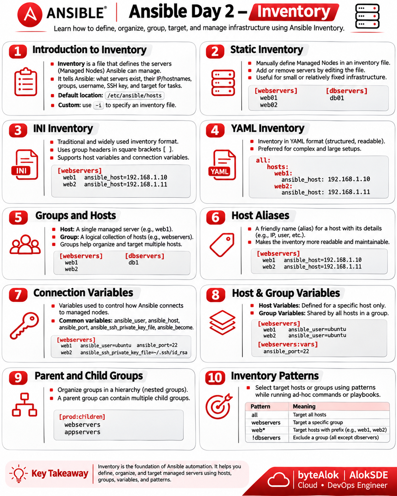
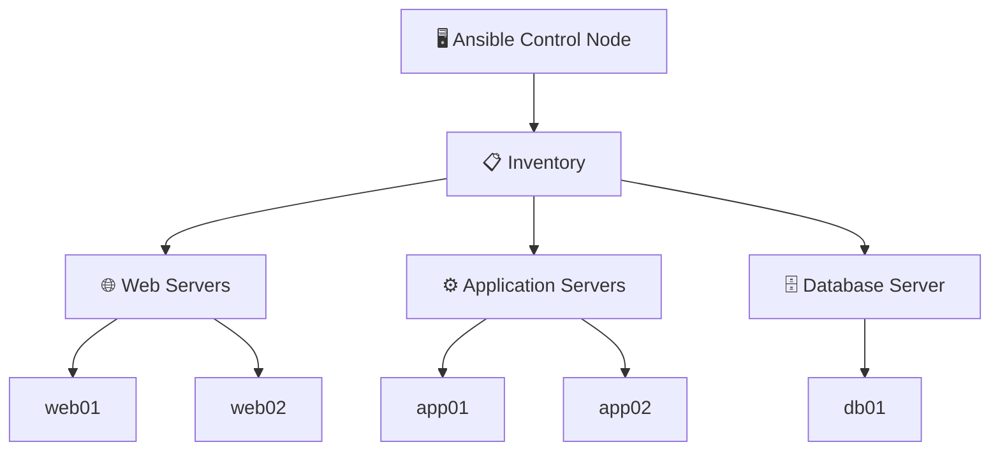
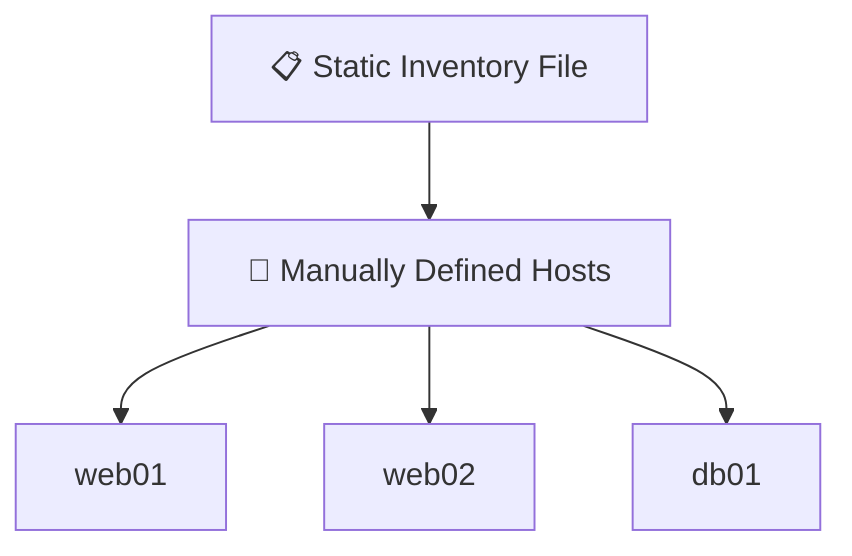
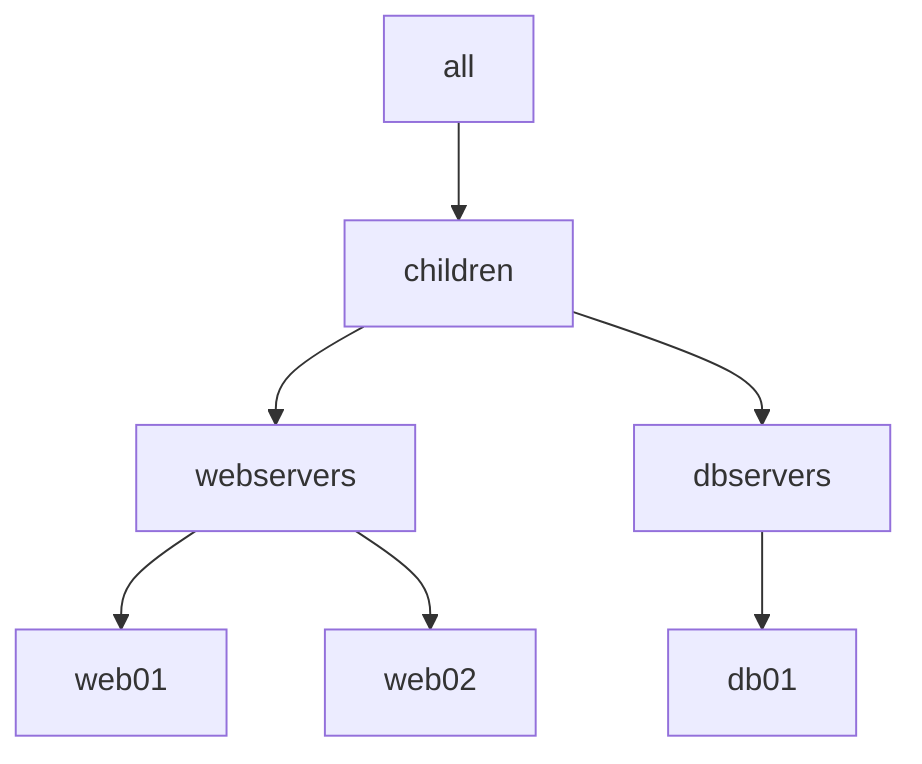
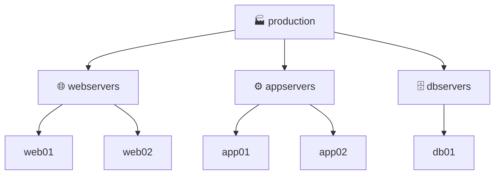
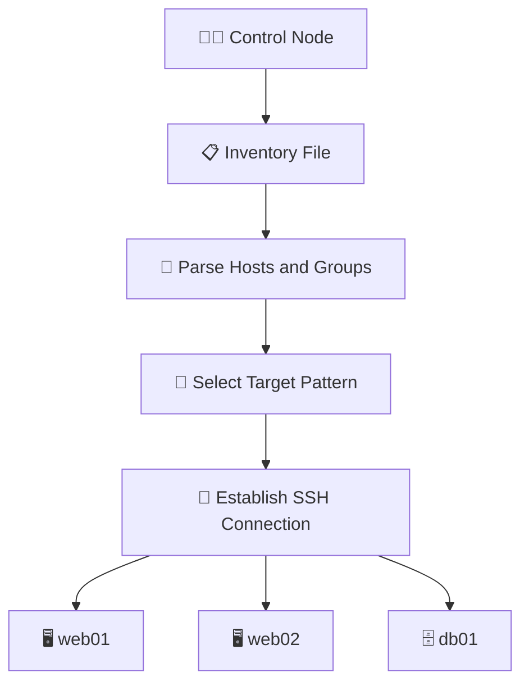

# 📦 Day 2 – Ansible Inventory

<p align="center">
  
  
  
  
</p>

<p align="center">
  <b>🚀 Learning how to define, organize, group, target, and manage infrastructure using Ansible Inventory.</b>
</p>

<p align="center">
  
</p>

---

# 📚 Table of Contents

> 💡 **Navigation Guide:** Click any topic below to jump directly to its section. If a navigation link does not work correctly, please check the corresponding section heading.

- [📋 1. Introduction to Inventory](#introduction-to-inventory)
  - [💡 1.1 What is Inventory?](#what-is-inventory)
  - [🎯 1.2 Why Does Ansible Need Inventory?](#why-ansible-needs-inventory)
  - [📁 1.3 Default Inventory Location](#default-inventory-location)
  - [⚙️ 1.4 Using a Custom Inventory File](#custom-inventory-file)

- [📄 2. Static Inventory](#static-inventory)
  - [🔍 2.1 What is Static Inventory?](#what-is-static-inventory)
  - [📌 2.2 Static Inventory Characteristics](#static-inventory-characteristics)
  - [📝 2.3 Static Inventory Example](#static-inventory-example)

- [🧾 3. INI Inventory](#ini-inventory)
  - [🔍 3.1 What is INI Inventory?](#what-is-ini-inventory)
  - [📝 3.2 Basic INI Inventory](#basic-ini-inventory)
  - [🧩 3.3 Hosts with Variables](#ini-hosts-with-variables)
  - [🔐 3.4 Connection Variables in INI](#ini-connection-variables)
  - [🔑 3.5 SSH Private Key Variable](#ini-private-key-variable)
  - [⚙️ 3.6 Privilege Escalation Variables](#ini-privilege-escalation-variables)

- [🐍 4. YAML Inventory](#yaml-inventory)
  - [🔍 4.1 What is YAML Inventory?](#what-is-yaml-inventory)
  - [📝 4.2 Basic YAML Inventory](#basic-yaml-inventory)
  - [🔎 4.3 Understanding YAML Syntax](#understanding-yaml-syntax)
  - [🏗️ 4.4 YAML Inventory with Groups](#yaml-inventory-with-groups)
  - [⚖️ 4.5 INI vs YAML Inventory](#ini-vs-yaml-inventory)

- [🖥️ 5. Groups and Hosts](#groups-and-hosts)
  - [🎯 5.1 What is a Host?](#what-is-a-host)
  - [📂 5.2 What is a Group?](#what-is-a-group)
  - [🔧 5.3 Creating Host Groups](#creating-host-groups)
  - [🚀 5.4 Why Groups are Important](#why-groups-are-important)

- [🏷️ 6. Host Aliases](#host-aliases)
  - [🔍 6.1 What is a Host Alias?](#what-is-a-host-alias)
  - [📝 6.2 Host Alias Example](#host-alias-example)
  - [🔄 6.3 How Host Aliases Work](#how-host-aliases-work)
  - [✨ 6.4 Benefits of Host Aliases](#benefits-of-host-aliases)

- [🔐 7. Connection Variables](#connection-variables)
  - [🔍 7.1 What are Connection Variables?](#what-are-connection-variables)
  - [📦 7.2 Important Connection Variables](#important-connection-variables)
  - [📝 7.3 Connection Variables Example](#connection-variables-example)
  - [🔑 7.4 SSH Private Key Variable](#ssh-private-key-variable)
  - [🛡️ 7.5 Privilege Escalation Variables](#privilege-escalation-variables)

- [🎯 8. Host Variables](#host-variables)
  - [🔍 8.1 What are Host Variables?](#what-are-host-variables)
  - [📝 8.2 Inline Host Variables](#inline-host-variables)
  - [🐍 8.3 Host Variables in YAML Inventory](#host-variables-in-yaml)
  - [⚙️ 8.4 Host Variable Use Cases](#host-variable-use-cases)

- [📂 9. Group Variables](#group-variables)
  - [🔍 9.1 What are Group Variables?](#what-are-group-variables)
  - [📝 9.2 INI Group Variables](#ini-group-variables)
  - [🐍 9.3 YAML Group Variables](#yaml-group-variables)
  - [⚖️ 9.4 Host Variables vs Group Variables](#host-vs-group-variables)

- [🌳 10. Parent and Child Groups](#parent-and-child-groups)
  - [🔍 10.1 Why Parent and Child Groups?](#why-parent-child-groups)
  - [📝 10.2 INI Parent and Child Groups](#ini-parent-child-groups)
  - [🐍 10.3 YAML Parent and Child Groups](#yaml-parent-child-groups)
  - [✨ 10.4 Why Parent Groups are Useful](#why-parent-groups-are-useful)

- [🎯 11. Inventory Patterns](#inventory-patterns)
  - [🔍 11.1 What are Inventory Patterns?](#what-are-inventory-patterns)
  - [📋 11.2 Common Inventory Patterns](#common-inventory-patterns)
  - [🌐 11.3 All Hosts](#pattern-all-hosts)
  - [📂 11.4 Specific Group](#pattern-specific-group)
  - [🖥️ 11.5 Specific Host](#pattern-specific-host)
  - [🔎 11.6 Wildcard Pattern](#pattern-wildcard)
  - [➕ 11.7 Union Pattern](#pattern-union)
  - [🔗 11.8 Intersection Pattern](#pattern-intersection)
  - [🚫 11.9 Exclusion Pattern](#pattern-exclusion)
  - [🧠 11.10 Pattern Operators](#pattern-operators)

- [📁 12. Inventory Directory Structure](#inventory-directory-structure)
  - [🔍 12.1 Why Use an Inventory Directory?](#why-inventory-directory)
  - [📄 12.2 Single Inventory File Structure](#single-inventory-file-structure)
  - [🏗️ 12.3 Multiple Environment Structure](#multiple-environment-structure)
  - [📝 12.4 Environment Inventory Examples](#environment-inventory-examples)
  - [🎯 12.5 Selecting an Inventory](#selecting-an-inventory)

- [🔎 13. Inventory Verification](#inventory-verification)
  - [📋 13.1 List Inventory](#list-inventory)
  - [🌳 13.2 Inventory Graph](#inventory-graph)
  - [🖥️ 13.3 Specific Host Information](#specific-host-information)
  - [📡 13.4 Verifying Connectivity](#verifying-connectivity)
  - [⌨️ 13.5 Verification Commands Summary](#verification-commands-summary)

- [🧪 14. Day 2 – Complete Practical Lab](#day-2-complete-practical-lab)
  - [📁 14.1 Creating Project Structure](#creating-project-structure)
  - [📝 14.2 Creating an Inventory File](#creating-inventory-file)
  - [🔎 14.3 Verifying the Inventory](#verifying-the-inventory)
  - [📡 14.4 Practical Inventory Workflow](#practical-inventory-workflow)

- [🧠 15. Predefined vs User-Created Components](#predefined-vs-user-created-components)
- [⚠️ 16. Common Mistakes](#common-mistakes)
- [📝 17. Complete Day 2 Revision Notes](#complete-day-2-revision-notes)
- [⌨️ 18. Important Commands Learned](#important-commands-learned)
- [🎓 19. Knowledge Check](#knowledge-check)
- [🏁 20. Final Recap](#final-recap)

---

# 📋 1. Introduction to Inventory

<a id="introduction-to-inventory"></a>

## 💡 1.1 What is Inventory?

<a id="what-is-inventory"></a>

**Inventory** is a file or collection of files in which we define the servers (Managed Nodes) that Ansible can manage.

Ansible needs to know:

- Which servers exist?
- What are their IP addresses or hostnames?
- Which servers belong to which group?
- Which username should be used to connect?
- Which SSH key should be used?
- Which servers should receive a particular task?

Inventory provides this information to Ansible.

### 💡 Simple Example

Suppose you have 5 AWS EC2 instances:

- 2 Web Servers
- 2 Application Servers
- 1 Database Server

Instead of manually specifying their IPs every time, you define them in an Inventory file and manage them through Ansible.



---

## 🎯 1.2 Why Does Ansible Need Inventory?

<a id="why-ansible-needs-inventory"></a>

Inventory helps Ansible identify and organize the systems on which automation should be performed.

### Without Inventory

You may need to manually specify server addresses or manage each server separately, which becomes difficult when infrastructure grows.

### With Inventory

You define the servers once and can target them by their names or groups.

For example:

```ini
[webservers]
192.168.1.10
192.168.1.11

[appservers]
192.168.1.20
192.168.1.21

[dbservers]
192.168.1.30
```

Here:

| Element | Meaning |
|---|---|
| `[webservers]` | Group name |
| `192.168.1.10` | Managed Node IP |
| `192.168.1.11` | Managed Node IP |
| `[appservers]` | Application servers group |
| `[dbservers]` | Database servers group |

`webservers`, `appservers`, and `dbservers` are user-created group names. They are not predefined Ansible group names.

---

## 📁 1.3 Default Inventory Location

<a id="default-inventory-location"></a>

Ansible's default inventory path is:

```text
/etc/ansible/hosts
```

This file is commonly used as the default inventory location.

However, we can also create our own inventory files inside our projects.

For example:

```text
ansible-project/
├── inventory
├── ansible.cfg
└── playbook.yml
```

Here, `inventory` is a custom inventory file created by us.

---

## ⚙️ 1.4 Using a Custom Inventory File

<a id="custom-inventory-file"></a>

If we are using a custom inventory file, we can provide its path using the `-i` option.

```bash
ansible -i inventory all -m ping
```

### 🔍 Command Breakdown

| Command | Meaning |
|---|---|
| `ansible` | Ansible ad-hoc command |
| `-i` | Option used to specify the inventory |
| `inventory` | Inventory file name |
| `all` | All target hosts in the inventory |
| `-m` | Option used to specify a module |
| `ping` | Ansible ping module |

`-i` and `-m` are predefined command-line options. `inventory` is the name of our file.

---

# 📄 2. Static Inventory

<a id="static-inventory"></a>

## 🔍 2.1 What is Static Inventory?

<a id="what-is-static-inventory"></a>

Static Inventory means we manually define the Managed Nodes inside an inventory file.

Whenever we add a server, we manually add its IP address or hostname to the inventory.

For example:

```ini
[webservers]
web01
web02

[dbservers]
db01
```

Here, Ansible is not automatically discovering servers from the cloud.

We are providing the server information ourselves.

---

## 📌 2.2 Static Inventory Characteristics

<a id="static-inventory-characteristics"></a>

- Servers are manually defined.
- IP addresses or hostnames are manually added.
- Groups are manually created.
- Adding or removing servers may require updating the inventory.
- Static inventory is useful for small or relatively fixed infrastructure.

### 🏗️ Static Inventory Illustration



---

## 📝 2.3 Static Inventory Example

<a id="static-inventory-example"></a>

```ini
[webservers]
web01
web02

[dbservers]
db01
```

Here:

- `web01` is a host.
- `web02` is a host.
- `db01` is a host.
- `webservers` is a group.
- `dbservers` is a group.

If these names are not resolvable through DNS or other hostname mapping, the actual IP address must be provided.

---

# 🧾 3. INI Inventory

<a id="ini-inventory"></a>

## 🔍 3.1 What is INI Inventory?

<a id="what-is-ini-inventory"></a>

INI is a simple text-based inventory format supported by Ansible.

In this format:

- Group names are written inside square brackets `[]`.
- Hosts are written below their respective groups.
- Variables can be written in key-value format.
- Hosts can be organized into groups.

INI format is one of the easiest inventory formats for beginners to understand.

---

## 📝 3.2 Basic INI Inventory

<a id="basic-ini-inventory"></a>

### Example

```ini
[webservers]
192.168.1.10
192.168.1.11

[dbservers]
192.168.1.20
```

### 🔍 Syntax Explanation

```ini
[webservers]
```

- `[` is the opening bracket.
- `webservers` is the group name.
- `]` is the closing bracket.

The group name is created by us.

```ini
192.168.1.10
```

This is the IP address of a Managed Node.

The hosts listed below a group heading belong to that group.

---

## 🧩 3.3 Hosts with Variables

<a id="ini-hosts-with-variables"></a>

We can define a host using an alias and assign variables to it.

```ini
[webservers]
web01 ansible_host=192.168.1.10
web02 ansible_host=192.168.1.11
```

Here:

| Element | Meaning |
|---|---|
| `web01` | Host alias |
| `ansible_host` | Predefined Ansible variable |
| `192.168.1.10` | Actual IP address |
| `web02` | Another host alias |
| `192.168.1.11` | Actual IP address of the second host |

Ansible identifies the host using the inventory name, but connects to the address defined by `ansible_host`.

---

## 🔐 3.4 Connection Variables in INI

<a id="ini-connection-variables"></a>

```ini
[webservers]
web01 ansible_host=192.168.1.10 ansible_user=ubuntu
web02 ansible_host=192.168.1.11 ansible_user=ubuntu
```

Here:

| Variable | Purpose |
|---|---|
| `ansible_host` | Actual IP address or hostname to connect to |
| `ansible_user` | Remote login username |

Variable names are predefined by Ansible, but we provide their values according to our infrastructure.

---

## 🔑 3.5 SSH Private Key Variable

<a id="ini-private-key-variable"></a>

```ini
[webservers]
web01 ansible_host=192.168.1.10 ansible_user=ubuntu ansible_ssh_private_key_file=~/.ssh/aws-key.pem
```

`ansible_ssh_private_key_file` tells Ansible which private key file to use for SSH authentication.

Here:

- The variable name is predefined.
- The key file path is provided by us.
- The key file must exist on the Control Node.
- The key file must have secure permissions.

The private key must never be uploaded to a public GitHub repository.

---

## ⚙️ 3.6 Privilege Escalation Variables

<a id="ini-privilege-escalation-variables"></a>

Example:

```ini
[webservers]
web01 ansible_host=192.168.1.10 ansible_user=ubuntu ansible_become=true
```

`ansible_become=true` tells Ansible to enable privilege escalation for remote task execution.

On Linux servers, privilege escalation is commonly required to perform root-level operations.

For example:

- Installing packages
- Modifying system configuration
- Managing system services
- Changing protected files

Privilege escalation will become more useful when working with Playbooks and Tasks.

---

# 🐍 4. YAML Inventory

<a id="yaml-inventory"></a>

## 🔍 4.1 What is YAML Inventory?

<a id="what-is-yaml-inventory"></a>

YAML is another inventory format supported by Ansible.

YAML uses indentation and key-value structures to define inventory information.

In INI format, we write:

```ini
[webservers]
web01
web02
```

The same inventory can be represented in YAML:

```yaml
all:
  hosts:
    web01:
      ansible_host: 192.168.1.10
    web02:
      ansible_host: 192.168.1.11
```

YAML is useful when inventory structures become more complex because it supports nested groups and structured variables.

---

## 📝 4.2 Basic YAML Inventory

<a id="basic-yaml-inventory"></a>

```yaml
all:
  hosts:
    web01:
      ansible_host: 192.168.1.10
    web02:
      ansible_host: 192.168.1.11
```

### 🔍 Understanding the Structure

```yaml
all:
```

`all` is a predefined inventory group that represents all hosts in the inventory.

```yaml
hosts:
```

This is the section where hosts are defined in this YAML structure.

```yaml
web01:
```

This is a host name created by us.

```yaml
ansible_host: 192.168.1.10
```

- `ansible_host` is a predefined Ansible variable.
- `192.168.1.10` is the address of the Managed Node.

---

## 🔎 4.3 Understanding YAML Syntax

<a id="understanding-yaml-syntax"></a>

YAML has a few important syntax rules.

| Symbol / Rule | Explanation |
|---|---|
| Indentation | Defines the structure and nesting |
| Spaces | Used for indentation; tabs should not be used |
| `:` | Separates a key from its value |
| `-` | Defines an item in a list |
| `{}` | Represents an empty mapping |
| `[]` | Represents an empty list |

### Example

```yaml
webservers:
  hosts:
    web01:
      ansible_host: 192.168.1.10
```

The indentation shows the relationship between the elements.

- `webservers` is the group.
- `hosts` contains the group members.
- `web01` is a host.
- `ansible_host` is a variable belonging to that host.

Incorrect indentation can cause YAML parsing errors or change the meaning of the structure.

---

## 🏗️ 4.4 YAML Inventory with Groups

<a id="yaml-inventory-with-groups"></a>

```yaml
all:
  children:
    webservers:
      hosts:
        web01:
          ansible_host: 192.168.1.10
        web02:
          ansible_host: 192.168.1.11

    dbservers:
      hosts:
        db01:
          ansible_host: 192.168.1.20
```

### 🔍 Structure Explanation

| Element | Meaning |
|---|---|
| `all` | Predefined top-level inventory group |
| `children` | Defines child groups |
| `webservers` | User-created group |
| `dbservers` | User-created group |
| `hosts` | Hosts belonging to a group |
| `web01` | User-created host name |
| `ansible_host` | Predefined host connection variable |

### 🗂️ Inventory Structure



---

## ⚖️ 4.5 INI vs YAML Inventory

<a id="ini-vs-yaml-inventory"></a>

| Feature | INI | YAML |
|---|---|---|
| Syntax | Simple text | Structured format |
| Groups | `[groupname]` | Nested structure |
| Variables | Inline `key=value` | Key-value mapping |
| Indentation | Not structure-dependent | Very important |
| Readability | Simple inventories | Complex inventories |
| File extension | `.ini`, `hosts` | `.yml`, `.yaml` |

Both formats can represent inventory information.

The choice depends on infrastructure complexity, readability, and the way you prefer to organize your inventory.

---

# 🖥️ 5. Groups and Hosts

<a id="groups-and-hosts"></a>

## 🎯 5.1 What is a Host?

<a id="what-is-a-host"></a>

A Host is an individual Managed Node that Ansible can target.

Examples:

- AWS EC2 instance
- Virtual Machine
- Physical server
- Linux server

A host can be defined using:

- IP address
- Hostname
- Inventory alias

Example:

```ini
192.168.1.10
```

Or:

```ini
web01 ansible_host=192.168.1.10
```

---

## 📂 5.2 What is a Group?

<a id="what-is-a-group"></a>

A Group is a logical collection of hosts organized into a category.

Example:

```ini
[webservers]
web01
web02
web03
```

Instead of manually specifying each server, we can target the entire `webservers` group.

Example:

```bash
ansible webservers -i inventory -m ping
```

This command targets all hosts belonging to the `webservers` group.

---

## 🔧 5.3 Creating Host Groups

<a id="creating-host-groups"></a>

```ini
[webservers]
web01
web02
web03

[appservers]
app01
app02

[dbservers]
db01
db02

[monitoring]
monitor01
monitor02
```

Here, we created four groups.

| Group | Purpose |
|---|---|
| `webservers` | Web servers |
| `appservers` | Application servers |
| `dbservers` | Database servers |
| `monitoring` | Monitoring servers |

These group names are created by us according to our infrastructure.

---

## 🚀 5.4 Why Groups are Important

<a id="why-groups-are-important"></a>

Suppose you have 50 servers:

- 10 Web Servers
- 20 Application Servers
- 10 Database Servers
- 10 Monitoring Servers

Managing every server individually becomes difficult.

Groups allow us to organize infrastructure and target servers based on their roles.

Instead of targeting individual hosts:

```bash
ansible web01 -i inventory -m ping
ansible web02 -i inventory -m ping
ansible web03 -i inventory -m ping
```

We can target the entire group:

```bash
ansible webservers -i inventory -m ping
```

This makes infrastructure management easier, more organized, and more scalable.

---

# 🏷️ 6. Host Aliases

<a id="host-aliases"></a>

## 🔍 6.1 What is a Host Alias?

<a id="what-is-a-host-alias"></a>

A Host Alias is a custom name assigned to an actual IP address or hostname in the inventory.

Instead of remembering IP addresses, we can use meaningful names to identify our Managed Nodes.

---

## 📝 6.2 Host Alias Example

<a id="host-alias-example"></a>

### Without Aliases

```ini
[webservers]
192.168.1.10
192.168.1.11
```

### With Aliases

```ini
[webservers]
web01 ansible_host=192.168.1.10
web02 ansible_host=192.168.1.11
```

This makes the inventory easier to understand.

---

## 🔄 6.3 How Host Aliases Work

<a id="how-host-aliases-work"></a>

Consider the following inventory entry:

```ini
web01 ansible_host=192.168.1.10
```

| Part | Meaning |
|---|---|
| `web01` | Custom inventory hostname or alias |
| `ansible_host` | Predefined connection variable |
| `192.168.1.10` | Actual destination IP |

Ansible uses `web01` as the inventory identity and connects to the address specified by `ansible_host`.

We can target the alias:

```bash
ansible web01 -i inventory -m ping
```

Instead of remembering the IP address every time, we can use the alias.

---

## ✨ 6.4 Benefits of Host Aliases

<a id="benefits-of-host-aliases"></a>

- Easy to remember
- More readable inventory
- Easier server identification
- Simplifies command execution
- Useful when IP addresses change
- Makes large infrastructure easier to organize

Example names:

```text
web01
web02
app01
app02
db01
monitor01
```

---

# 🔐 7. Connection Variables

<a id="connection-variables"></a>

## 🔍 7.1 What are Connection Variables?

<a id="what-are-connection-variables"></a>

Connection Variables tell Ansible how to establish a connection with a Managed Node.

These variables can provide information such as:

- Remote username
- Connection type
- SSH port
- Private key
- Privilege escalation settings

Connection variables are particularly important when managing servers with different connection requirements.

---

## 📦 7.2 Important Connection Variables

<a id="important-connection-variables"></a>

These are predefined Ansible variables. We do not invent their names, but we assign their values according to our infrastructure.

| Variable | Purpose |
|---|---|
| `ansible_host` | Actual IP address or hostname |
| `ansible_user` | Remote login username |
| `ansible_port` | Connection port |
| `ansible_connection` | Connection type |
| `ansible_ssh_private_key_file` | SSH private key path |
| `ansible_become` | Enable privilege escalation |
| `ansible_become_method` | Privilege escalation method |

---

## 📝 7.3 Connection Variables Example

<a id="connection-variables-example"></a>

```ini
[webservers]
web01 ansible_host=192.168.1.10 ansible_user=ubuntu ansible_port=22
```

### 🔍 Breakdown

```ini
web01
```

Inventory alias.

```ini
ansible_host=192.168.1.10
```

Actual target address.

```ini
ansible_user=ubuntu
```

Remote SSH login username.

```ini
ansible_port=22
```

SSH port.

Port 22 is the default SSH port. We explicitly specify it here for learning purposes; it is often unnecessary when the server uses the standard SSH port.

---

## 🔑 7.4 SSH Private Key Variable

<a id="ssh-private-key-variable"></a>

```ini
[webservers]
web01 ansible_host=192.168.1.10 ansible_user=ubuntu ansible_ssh_private_key_file=~/.ssh/aws-key.pem
```

`ansible_ssh_private_key_file` tells Ansible which private key file to use for SSH authentication.

Here:

- The variable name is predefined.
- The key file path is provided by us.
- The key file must exist on the Control Node.
- The key file must have secure permissions.

The private key should never be uploaded to a public GitHub repository.

---

## 🛡️ 7.5 Privilege Escalation Variables

<a id="privilege-escalation-variables"></a>

Example:

```ini
[webservers]
web01 ansible_host=192.168.1.10 ansible_user=ubuntu ansible_become=true
```

`ansible_become=true` tells Ansible to enable privilege escalation for remote task execution.

On Linux servers, privilege escalation is commonly required to perform root-level operations.

For example:

- Installing packages
- Modifying system configuration
- Managing system services
- Changing protected files

Privilege escalation will become more useful when working with Playbooks and Tasks.

---

# 🎯 8. Host Variables

<a id="host-variables"></a>

## 🔍 8.1 What are Host Variables?

<a id="what-are-host-variables"></a>

Host Variables are variables assigned to a specific host.

If every server has a different configuration, we can define variables for each individual server.

For example:

- Different application ports
- Different application versions
- Different directory paths
- Different server configurations
- Different environment settings

---

## 📝 8.2 Inline Host Variables

<a id="inline-host-variables"></a>

```ini
[webservers]
web01 ansible_host=192.168.1.10 app_port=8080
web02 ansible_host=192.168.1.11 app_port=9090
```

Here:

| Host | `app_port` |
|---|---:|
| `web01` | 8080 |
| `web02` | 9090 |

`app_port` is a custom variable created by us. It is not a predefined Ansible variable.

Each host has its own application port.

---

## 🐍 8.3 Host Variables in YAML Inventory

<a id="host-variables-in-yaml"></a>

```yaml
all:
  hosts:
    web01:
      ansible_host: 192.168.1.10
      app_port: 8080

    web02:
      ansible_host: 192.168.1.11
      app_port: 9090
```

Each host has its own variables.

### 🔍 Understanding the Structure

- `all` → predefined inventory group
- `hosts` → hosts section
- `web01` → user-created host
- `ansible_host` → predefined connection variable
- `app_port` → user-created variable

---

## ⚙️ 8.4 Host Variable Use Cases

<a id="host-variable-use-cases"></a>

Host Variables are useful when servers need individual configuration.

For example:

| Host | Application Port | Application Version |
|---|---:|---|
| `web01` | 8080 | 1.0 |
| `web02` | 9090 | 2.0 |
| `web03` | 3000 | 1.5 |

Instead of using the same configuration for every host, we can define individual values for each server.

---

# 📂 9. Group Variables

<a id="group-variables"></a>

## 🔍 9.1 What are Group Variables?

<a id="what-are-group-variables"></a>

Group Variables are variables assigned to a group and shared by its member hosts.

Suppose 10 Web Servers use the same:

- Application port
- Package
- Configuration
- Application directory

Instead of defining the same variable on every host, we can define it at the group level.

---

## 📝 9.2 INI Group Variables

<a id="ini-group-variables"></a>

```ini
[webservers]
web01 ansible_host=192.168.1.10
web02 ansible_host=192.168.1.11

[webservers:vars]
app_port=8080
app_name=myapp
```

### 🔍 Breakdown

| Element | Meaning |
|---|---|
| `[webservers]` | Host group |
| `[webservers:vars]` | Group variables section |
| `app_port` | User-created variable |
| `app_name` | User-created variable |

Both hosts receive the same group variables.

| Host | `app_port` | `app_name` |
|---|---:|---|
| web01 | 8080 | myapp |
| web02 | 8080 | myapp |

---

## 🐍 9.3 YAML Group Variables

<a id="yaml-group-variables"></a>

```yaml
all:
  children:
    webservers:
      vars:
        app_port: 8080
        app_name: myapp

      hosts:
        web01:
          ansible_host: 192.168.1.10

        web02:
          ansible_host: 192.168.1.11
```

### 🔍 Structure

- `webservers` → Group
- `vars` → Group variables section
- `app_port` → User-created variable
- `app_name` → User-created variable
- `hosts` → Group members

Both `web01` and `web02` belong to the `webservers` group and share its variables.

---

## ⚖️ 9.4 Host Variables vs Group Variables

<a id="host-vs-group-variables"></a>

| Host Variables | Group Variables |
|---|---|
| Apply to a specific host | Apply to hosts belonging to a group |
| Individual configuration | Shared configuration |
| Useful for unique settings | Useful for common settings |
| Example: `web01 app_port=8080` | Example: all webservers `app_port=8080` |

### 💡 When to Use Which?

Use Host Variables when a particular server requires a different configuration.

Use Group Variables when multiple servers share the same configuration.

This avoids unnecessary repetition and makes inventory easier to maintain.

---

# 🌳 10. Parent and Child Groups

<a id="parent-and-child-groups"></a>

## 🔍 10.1 Why Parent and Child Groups?

<a id="why-parent-child-groups"></a>

In large infrastructures, groups can be organized into higher-level groups.

Suppose we have:

- Web Servers
- Application Servers
- Database Servers

We want to organize all of them under a common group called `production`.

This relationship can be created using Parent and Child Groups.

### 🏗️ Group Hierarchy



Here:

- `production` → Parent Group
- `webservers` → Child Group
- `appservers` → Child Group
- `dbservers` → Child Group

---

## 📝 10.2 INI Parent and Child Groups

<a id="ini-parent-child-groups"></a>

```ini
[webservers]
web01
web02

[appservers]
app01
app02

[dbservers]
db01

[production:children]
webservers
appservers
dbservers
```

### 🔍 Understanding `[production:children]`

`production:children` tells Ansible that the `production` group contains child groups.

- `production` → Parent group name created by us
- `:children` → Special inventory syntax used to define child groups
- `webservers` → Child group
- `appservers` → Child group
- `dbservers` → Child group

Now we can target the `production` group.

```bash
ansible production -i inventory -m ping
```

This targets the hosts belonging to the production group, including its child groups.

---

## 🐍 10.3 YAML Parent and Child Groups

<a id="yaml-parent-child-groups"></a>

```yaml
all:
  children:
    production:
      children:
        webservers:
          hosts:
            web01:
            web02:

        appservers:
          hosts:
            app01:
            app02:

        dbservers:
          hosts:
            db01:
```

In YAML, the nested `children` structure creates the parent-child relationship.

### 🌳 Hierarchy

```text
all
└── production
    ├── webservers
    │   ├── web01
    │   └── web02
    ├── appservers
    │   ├── app01
    │   └── app02
    └── dbservers
        └── db01
```

---

## ✨ 10.4 Why Parent Groups are Useful

<a id="why-parent-groups-are-useful"></a>

Suppose a production infrastructure has 100 servers.

Instead of targeting each group separately:

```bash
ansible webservers -i inventory -m ping
ansible appservers -i inventory -m ping
ansible dbservers -i inventory -m ping
```

We can target:

```bash
ansible production -i inventory -m ping
```

Parent Groups make it easier to organize and manage large infrastructure.

---

# 🎯 11. Inventory Patterns

<a id="inventory-patterns"></a>

## 🔍 11.1 What are Inventory Patterns?

<a id="what-are-inventory-patterns"></a>

Inventory Patterns are expressions used to select which hosts from the inventory Ansible should target.

Patterns are used in Ansible commands and Playbooks to determine the target hosts.

For example:

```bash
ansible all -i inventory -m ping
```

Here:

`all` is a pattern that selects all hosts in the selected inventory.

---

## 📋 11.2 Common Inventory Patterns

<a id="common-inventory-patterns"></a>

| Pattern | Meaning |
|---|---|
| `all` | All inventory hosts |
| `webservers` | All hosts in the webservers group |
| `web01` | A specific host |
| `*` | Wildcard matching |
| `web*` | Hosts matching the web prefix |
| `webservers:dbservers` | Union of groups |
| `webservers:&production` | Intersection |
| `production:!dbservers` | Exclude dbservers |

---

## 🌐 11.3 All Hosts

<a id="pattern-all-hosts"></a>

```bash
ansible all -i inventory -m ping
```

`all` targets every host in the selected inventory.

---

## 📂 11.4 Specific Group

<a id="pattern-specific-group"></a>

```bash
ansible webservers -i inventory -m ping
```

Only hosts belonging to the `webservers` group will be targeted.

---

## 🖥️ 11.5 Specific Host

<a id="pattern-specific-host"></a>

```bash
ansible web01 -i inventory -m ping
```

Only `web01` will be targeted.

---

## 🔎 11.6 Wildcard Pattern

<a id="pattern-wildcard"></a>

```bash
ansible 'web*' -i inventory -m ping
```

`web*` means:

- `web` → Matching host name prefix
- `*` → Zero or more characters

Example matches:

```text
web01
web02
webserver
web-prod
```

The actual matches depend on the inventory host names.

Quotes are helpful because they prevent the shell from interpreting the wildcard before Ansible receives it.

---

## ➕ 11.7 Union Pattern

<a id="pattern-union"></a>

```bash
ansible 'webservers:dbservers' -i inventory -m ping
```

The colon `:` acts as a union operator when combining host patterns.

Meaning:

```text
webservers OR dbservers
```

Hosts from both groups will be targeted.

---

## 🔗 11.8 Intersection Pattern

<a id="pattern-intersection"></a>

```bash
ansible 'webservers:&production' -i inventory -m ping
```

Intersection means hosts matching both patterns.

Meaning:

```text
webservers AND production
```

Only hosts that belong to both groups will be selected.

---

## 🚫 11.9 Exclusion Pattern

<a id="pattern-exclusion"></a>

```bash
ansible 'production:!dbservers' -i inventory -m ping
```

Meaning:

```text
production EXCEPT dbservers
```

Hosts in the production group will be selected, but database servers will be excluded.

---

## 🧠 11.10 Pattern Operators

<a id="pattern-operators"></a>

| Operator | Meaning | Example |
|---|---|---|
| `:` | Union / OR | `webservers:dbservers` |
| `&` | Intersection / AND | `webservers:&production` |
| `!` | Exclusion / NOT | `production:!dbservers` |
| `*` | Wildcard | `web*` |

### 💡 Remember

Inventory Patterns allow us to select hosts based on:

- All hosts
- Specific groups
- Specific hosts
- Matching host names
- Multiple groups
- Common groups
- Excluded groups

This becomes very useful when infrastructure contains many servers.

---

# 📁 12. Inventory Directory Structure

<a id="inventory-directory-structure"></a>

## 🔍 12.1 Why Use an Inventory Directory?

<a id="why-inventory-directory"></a>

For small infrastructure, a single inventory file may be sufficient.

However, production infrastructure may contain multiple environments:

- Development
- Testing
- Staging
- Production

Managing all these environments in a single file can become complicated.

Inventory directories help organize multiple inventories separately.

---

## 📄 12.2 Single Inventory File Structure

<a id="single-inventory-file-structure"></a>

```text
ansible-project/
├── inventory
├── ansible.cfg
└── playbook.yml
```

| File | Purpose |
|---|---|
| `inventory` | Hosts and groups |
| `ansible.cfg` | Ansible configuration |
| `playbook.yml` | Automation instructions |

---

## 🏗️ 12.3 Multiple Environment Structure

<a id="multiple-environment-structure"></a>

```text
ansible-project/
├── inventories/
│   ├── dev/
│   │   └── hosts
│   ├── staging/
│   │   └── hosts
│   └── production/
│       └── hosts
│
├── playbooks/
│   └── deploy.yml
│
└── ansible.cfg
```

### 📂 Directory Explanation

| Directory | Purpose |
|---|---|
| `inventories/` | Parent directory for inventory environments |
| `dev/` | Development environment hosts |
| `staging/` | Staging environment hosts |
| `production/` | Production environment hosts |
| `playbooks/` | Automation playbooks |

---

## 📝 12.4 Environment Inventory Examples

<a id="environment-inventory-examples"></a>

### 🧪 Development

File:

```text
inventories/dev/hosts
```

```ini
[webservers]
dev-web01 ansible_host=10.0.1.10
dev-web02 ansible_host=10.0.1.11
```

### 🧫 Staging

File:

```text
inventories/staging/hosts
```

```ini
[webservers]
stage-web01 ansible_host=10.0.2.10
stage-web02 ansible_host=10.0.2.11
```

### 🚀 Production

File:

```text
inventories/production/hosts
```

```ini
[webservers]
prod-web01 ansible_host=10.0.3.10
prod-web02 ansible_host=10.0.3.11
```

This structure keeps the environments separate and easier to manage.

---

## 🎯 12.5 Selecting an Inventory

<a id="selecting-an-inventory"></a>

We can specify the inventory file using the `-i` option.

### 🧪 Development

```bash
ansible all -i inventories/dev/hosts -m ping
```

### 🧫 Staging

```bash
ansible all -i inventories/staging/hosts -m ping
```

### 🚀 Production

```bash
ansible all -i inventories/production/hosts -m ping
```

The same command can be used with different inventory files.

This is useful in production infrastructure because it helps reduce the risk of accidentally targeting development hosts instead of production hosts, provided we select the correct inventory.

---

# 🔎 13. Inventory Verification

<a id="inventory-verification"></a>

After creating an inventory, it is important to verify that Ansible is reading it correctly.

The `ansible-inventory` command is used to inspect inventory information.

---

## 📋 13.1 List Inventory

<a id="list-inventory"></a>

```bash
ansible-inventory -i inventory --list
```

### 🔍 Command Breakdown

| Part | Meaning |
|---|---|
| `ansible-inventory` | Inventory inspection CLI |
| `-i inventory` | Specifies the inventory file |
| `--list` | Displays inventory in a structured format |

This command displays hosts and groups in a JSON-like structure.

---

## 🌳 13.2 Inventory Graph

<a id="inventory-graph"></a>

```bash
ansible-inventory -i inventory --graph
```

`--graph` displays groups and hosts in a tree-like format.

### Example Output

```text
@all:
  |--@production:
  |  |--@webservers:
  |  |  |--web01
  |  |  |--web02
  |  |--@dbservers:
  |  |  |--db01
```

This makes the group hierarchy easier to understand.

---

## 🖥️ 13.3 Specific Host Information

<a id="specific-host-information"></a>

```bash
ansible-inventory -i inventory --host web01
```

`--host` displays the inventory information for a specific host.

### Example Output

```json
{
    "ansible_host": "192.168.1.10",
    "ansible_user": "ubuntu",
    "app_port": 8080
}
```

These values come from the inventory and the variables assigned to that host.

---

## 📡 13.4 Verifying Connectivity

<a id="verifying-connectivity"></a>

```bash
ansible all -i inventory -m ping
```

This executes the Ansible `ping` module against the selected inventory hosts.

### Successful Result

```text
web01 | SUCCESS => {
    "changed": false,
    "ping": "pong"
}
```

Ansible Ping is not the same as ICMP ping.

It verifies Ansible's ability to connect, execute its module, and receive a response from the Managed Node.

---

## ⌨️ 13.5 Verification Commands Summary

<a id="verification-commands-summary"></a>

| Command | Purpose |
|---|---|
| `ansible-inventory -i inventory --list` | Display complete inventory |
| `ansible-inventory -i inventory --graph` | Display group hierarchy |
| `ansible-inventory -i inventory --host web01` | Display specific host variables |
| `ansible all -i inventory -m ping` | Verify connectivity to all hosts |
| `ansible webservers -i inventory -m ping` | Verify a specific group |

---

# 🧪 14. Day 2 – Complete Practical Lab

<a id="day-2-complete-practical-lab"></a>

Now we will combine the Day 2 concepts into a single practical inventory setup.

In this lab, we will use three EC2 servers:

| Host | Role | IP |
|---|---|---|
| `web01` | Web Server | `10.0.1.10` |
| `web02` | Web Server | `10.0.1.11` |
| `db01` | Database Server | `10.0.1.20` |

> ⚠️ These IP addresses are examples. Use your actual EC2 private IP addresses.

---

## 📁 14.1 Creating Project Structure

<a id="creating-project-structure"></a>

On the Control Node:

```bash
mkdir ansible-day2
cd ansible-day2
```

### 🔍 Command Explanation

#### `mkdir`

A Linux command used to create a directory.

#### `ansible-day2`

The directory name is chosen by us.

#### `cd`

A Linux command used to change the current working directory.

#### `ansible-day2`

The directory we want to enter.

---

## 📝 14.2 Creating an Inventory File

<a id="creating-inventory-file"></a>

Create the inventory file:

```bash
nano inventory
```

`nano` is a terminal-based text editor.

Write the following configuration inside the file:

```ini
[webservers]
web01 ansible_host=10.0.1.10 ansible_user=ubuntu
web02 ansible_host=10.0.1.11 ansible_user=ubuntu

[dbservers]
db01 ansible_host=10.0.1.20 ansible_user=ubuntu

[production:children]
webservers
dbservers

[production:vars]
ansible_ssh_private_key_file=~/.ssh/ansible-key.pem
ansible_port=22

[webservers:vars]
app_port=8080
app_name=myapp
```

### 🔍 Inventory Breakdown

| Element | Type | Created By |
|---|---|---|
| `webservers` | Group | User |
| `dbservers` | Group | User |
| `production` | Parent Group | User |
| `web01` | Host Alias | User |
| `web02` | Host Alias | User |
| `db01` | Host Alias | User |
| `ansible_host` | Predefined variable | Ansible |
| `ansible_user` | Predefined variable | Ansible |
| `ansible_ssh_private_key_file` | Predefined variable | Ansible |
| `ansible_port` | Predefined variable | Ansible |
| `app_port` | Custom variable | User |
| `app_name` | Custom variable | User |

---

## 🔎 14.3 Verifying the Inventory

<a id="verifying-the-inventory"></a>

### Step 1 — List Inventory

```bash
ansible-inventory -i inventory --list
```

### Step 2 — View Group Structure

```bash
ansible-inventory -i inventory --graph
```

### Step 3 — Verify Host Details

```bash
ansible-inventory -i inventory --host web01
```

### Step 4 — Verify Webservers Group

```bash
ansible webservers -i inventory -m ping
```

### Step 5 — Verify Database Group

```bash
ansible dbservers -i inventory -m ping
```

### Step 6 — Verify Production Group

```bash
ansible production -i inventory -m ping
```

This command targets the hosts belonging to the `production` group, including its child groups.

---

## 📡 14.4 Practical Inventory Workflow

<a id="practical-inventory-workflow"></a>



### Workflow Explanation

1. The user executes an Ansible command from the Control Node.
2. Ansible reads the selected inventory.
3. Ansible identifies hosts and groups.
4. The requested target pattern selects the hosts.
5. Ansible uses the connection details from the inventory.
6. SSH connections are established with the Managed Nodes.
7. Ansible executes the requested module or automation.
8. Results are returned to the Control Node.

Inventory helps Ansible understand which servers exist, how they are organized, and which connection information is available.

---

# 🧠 15. Predefined vs User-Created Components

<a id="predefined-vs-user-created-components"></a>

This concept is very important. You should know which components Ansible already provides and which components we create ourselves.

| Component | Predefined / User-Created |
|---|---|
| `ansible_host` | Predefined |
| `ansible_user` | Predefined |
| `ansible_port` | Predefined |
| `ansible_connection` | Predefined |
| `ansible_ssh_private_key_file` | Predefined |
| `ansible_become` | Predefined |
| `all` group | Predefined |
| `children` | Predefined inventory keyword |
| `hosts` | Predefined inventory keyword |
| `vars` | Predefined inventory keyword |
| `webservers` | User-created |
| `dbservers` | User-created |
| `production` | User-created |
| `web01` | User-created |
| `db01` | User-created |
| `app_port` | User-created variable |
| `app_name` | User-created variable |
| `inventory` filename | User-selected |
| `hosts` filename | User-selected |

### 💡 Golden Rule

> **A variable name may be predefined, but its value is supplied according to our infrastructure.**

Example:

```ini
ansible_user=ubuntu
```

- `ansible_user` → Predefined variable
- `ubuntu` → Value provided by us

---

# ⚠️ 16. Common Mistakes

<a id="common-mistakes"></a>

## ❌ 1. Incorrect YAML Indentation

Wrong:

```yaml
webservers:
hosts:
web01:
```

Correct:

```yaml
webservers:
  hosts:
    web01:
```

YAML indentation defines the structure.

---

## ❌ 2. Using Tabs Instead of Spaces

YAML indentation should use spaces, not tabs.

Incorrect indentation can cause parsing errors.

---

## ❌ 3. Confusing an Alias with the Actual IP

```ini
web01 ansible_host=10.0.1.10
```

- `web01` → Inventory identity
- `10.0.1.10` → Actual connection address

These are not the same thing.

---

## ❌ 4. Using the Wrong Group Name

Inventory:

```ini
[webservers]
web01
web02
```

Command:

```bash
ansible servers -i inventory -m ping
```

The `servers` group does not exist in this inventory.

Correct:

```bash
ansible webservers -i inventory -m ping
```

---

## ❌ 5. Using the Wrong Inventory File Path

```bash
ansible all -i inventry -m ping
```

If the actual file name is `inventory`, then `inventry` is incorrect.

---

## ❌ 6. Incorrect Connection Variables

Example:

```ini
web01 ansible_host=10.0.1.10 ansible_user=ec2-user
```

If the target is an Ubuntu EC2 instance, its default username is generally `ubuntu`, not `ec2-user`.

The remote username depends on the operating system image.

---

## ❌ 7. Mixing Host Variables and Group Variables

Host Variables apply to an individual host.

Group Variables apply to hosts belonging to a group.

If a variable is common to every server, defining it at the group level is usually more maintainable.

---

## ❌ 8. Incorrect Parent Group Syntax

INI:

```ini
[production:children]
webservers
dbservers
```

The `:children` syntax is important.

Without the correct syntax, the child group relationship will not be created as intended.

---

## ❌ 9. Not Verifying Inventory

After creating an inventory file, verify it before running your automation.

```bash
ansible-inventory -i inventory --graph
```

This helps check the group and host structure.

---

## ❌ 10. Accidentally Targeting Production

```bash
ansible all -i inventories/production/hosts -m ping
```

`all` means all hosts in the selected inventory, not all servers everywhere.

Always check the inventory path and target pattern before executing a command.

---

# 📝 17. Complete Day 2 Revision Notes

<a id="complete-day-2-revision-notes"></a>

## 📋 Inventory

Inventory provides Ansible with information about the Managed Nodes.

It can define:

- Hosts
- IP addresses
- Host aliases
- Groups
- Connection Variables
- Host Variables
- Group Variables
- Parent-Child Group relationships

---

## 📄 Static Inventory

Hosts are manually defined in an inventory file.

```ini
[webservers]
web01
web02
```

---

## 🧾 INI Inventory

Group-based format:

```ini
[webservers]
web01
web02
```

Variables:

```ini
web01 ansible_host=10.0.1.10 ansible_user=ubuntu
```

---

## 🐍 YAML Inventory

Structured format:

```yaml
all:
  hosts:
    web01:
      ansible_host: 10.0.1.10
```

---

## 🖥️ Groups and Hosts

- Host → Individual server
- Group → Multiple hosts organized logically

Example:

```ini
[webservers]
web01
web02
```

---

## 🏷️ Host Alias

```ini
web01 ansible_host=10.0.1.10
```

`web01` is the alias, while `ansible_host` defines the actual destination.

---

## 🔐 Connection Variables

| Variable | Purpose |
|---|---|
| `ansible_host` | Target IP/hostname |
| `ansible_user` | SSH username |
| `ansible_port` | Connection port |
| `ansible_connection` | Connection type |
| `ansible_ssh_private_key_file` | Private key path |
| `ansible_become` | Privilege escalation |

---

## 🎯 Host Variables

Variables assigned to individual hosts.

```ini
web01 app_port=8080
web02 app_port=9090
```

---

## 📂 Group Variables

Variables shared by hosts belonging to a group.

```ini
[webservers:vars]
app_port=8080
```

---

## 🌳 Parent and Child Groups

```ini
[production:children]
webservers
dbservers
```

Parent groups help organize multiple groups.

---

## 🎯 Inventory Patterns

| Pattern | Meaning |
|---|---|
| `all` | All hosts |
| `webservers` | Specific group |
| `web01` | Specific host |
| `web*` | Wildcard |
| `webservers:dbservers` | Union |
| `webservers:&production` | Intersection |
| `production:!dbservers` | Exclusion |

---

## 📁 Inventory Directory

Multiple environments can be organized using separate inventory files.

```text
inventories/
├── dev/
│   └── hosts
├── staging/
│   └── hosts
└── production/
    └── hosts
```

---

## 🔎 Inventory Verification

```bash
ansible-inventory -i inventory --list
```

```bash
ansible-inventory -i inventory --graph
```

```bash
ansible-inventory -i inventory --host web01
```

```bash
ansible all -i inventory -m ping
```

---

# ⌨️ 18. Important Commands Learned

<a id="important-commands-learned"></a>

| Command | Purpose |
|---|---|
| `mkdir ansible-day2` | Create a directory |
| `cd ansible-day2` | Change directory |
| `nano inventory` | Create or edit an inventory file |
| `ansible-inventory -i inventory --list` | Display inventory |
| `ansible-inventory -i inventory --graph` | Display inventory hierarchy |
| `ansible-inventory -i inventory --host web01` | Display specific host details |
| `ansible all -i inventory -m ping` | Test all hosts |
| `ansible webservers -i inventory -m ping` | Test the webservers group |
| `ansible dbservers -i inventory -m ping` | Test the database group |
| `ansible production -i inventory -m ping` | Test the parent group |

### 🔍 Command Components

| Component | Type | Purpose |
|---|---|---|
| `ansible` | Command | Execute Ansible ad-hoc commands |
| `ansible-inventory` | Command | Inspect inventory information |
| `-i` | Option | Specify inventory |
| `-m` | Option | Specify module |
| `--list` | Option | Display inventory |
| `--graph` | Option | Display group hierarchy |
| `--host` | Option | Display a specific host |
| `ping` | Module | Verify Ansible connectivity |
| `all` | Pattern | Select all hosts |
| `webservers` | Group | Select web server hosts |
| `production` | Group | Select parent group |

---

# 🎓 19. Knowledge Check

<a id="knowledge-check"></a>

Try to answer these questions without looking at your notes.

## 🧠 Day 2 Test — Inventory Fundamentals

### Q1. What is Ansible Inventory?

### Q2. What is Static Inventory?

### Q3. What is the difference between INI and YAML Inventory?

### Q4. What is the purpose of this syntax?

```ini
[webservers]
web01
web02
```

### Q5. What is the difference between these two?

```ini
web01 ansible_host=10.0.1.10
```

- `web01`
- `ansible_host`

### Q6. What is a Host Alias?

### Q7. What is the purpose of `ansible_user`?

### Q8. What is the difference between Host Variables and Group Variables?

### Q9. What is a Parent Group?

### Q10. What is the meaning of this pattern?

```bash
ansible 'production:!dbservers' -i inventory -m ping
```

### Q11. What will this command display?

```bash
ansible-inventory -i inventory --graph
```

### Q12. How can you check the variables assigned to a specific host?

### Q13. What is the difference between these two commands?

```bash
ansible all -i inventory -m ping
```

```bash
ansible webservers -i inventory -m ping
```

### Q14. Are `webservers`, `production`, and `dbservers` predefined Ansible groups?

### Q15. Why do we use multiple inventory files for Dev, Staging, and Production?

---

# 🏁 20. Final Recap

<a id="final-recap"></a>

<p align="center">
  
  
</p>

## 🎯 What You Learned

| Topic | Learning Outcome |
|---|---|
| 📋 Inventory | Understand how Ansible identifies Managed Nodes |
| 📄 Static Inventory | Manually define hosts and servers |
| 🧾 INI Inventory | Create group-based inventories |
| 🐍 YAML Inventory | Organize inventory using YAML structures |
| 🖥️ Groups and Hosts | Organize servers by their roles |
| 🏷️ Host Aliases | Use meaningful names instead of IP addresses |
| 🔐 Connection Variables | Define connection details |
| 🎯 Host Variables | Configure individual hosts |
| 📂 Group Variables | Share configuration across groups |
| 🌳 Parent and Child Groups | Create group hierarchies |
| 🎯 Inventory Patterns | Select and filter target hosts |
| 📁 Inventory Directory | Organize Dev, Staging, and Production |
| 🔎 Inventory Verification | Inspect and validate inventories |

---

## 🚀 After Completing Day 2

You should now be able to:

- Create Static Inventory files.
- Write INI Inventory.
- Write YAML Inventory.
- Add hosts and groups.
- Assign host aliases.
- Configure connection variables.
- Define Host Variables and Group Variables.
- Create Parent and Child Groups.
- Use Inventory Patterns for host selection.
- Organize Dev, Staging, and Production inventories.
- Verify inventory using `ansible-inventory`.
- Test Managed Node connectivity using Ansible Ping.

---

## 🏆 Day 2 Completion

```text
📋 Inventory Fundamentals
        │
        ├── 📄 Static Inventory
        ├── 🧾 INI Inventory
        ├── 🐍 YAML Inventory
        ├── 🖥️ Groups and Hosts
        ├── 🏷️ Host Aliases
        ├── 🔐 Connection Variables
        ├── 🎯 Host Variables
        ├── 📂 Group Variables
        ├── 🌳 Parent and Child Groups
        ├── 🔎 Inventory Patterns
        ├── 📁 Inventory Directory Structure
        └── ✅ Inventory Verification
```

<p align="center">
  <b>Day 2 Completed — Building a strong foundation in Ansible Inventory and Infrastructure Organization. 🚀</b>
</p>

<p align="center">
  <i>Learn it. Practice it. Automate it. Repeat it.</i>
</p>
